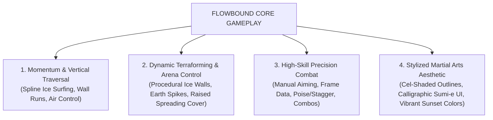
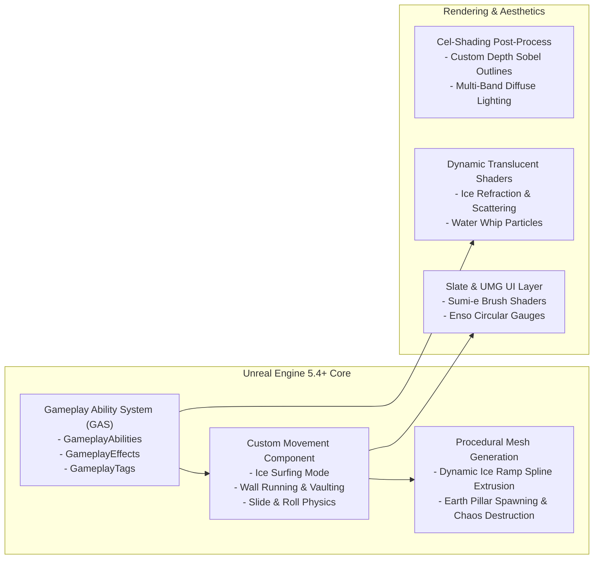

# 01 — Executive Summary & Game Specification

## 1. Project Overview & Identity

**Title:** Flowbound: Masters of Four  
**Genre:** Fast-Paced Competitive 3D Elemental Arena Fighter / Third-Person Martial Arts PvP  
**Target Platform:** PC (Windows 10/11 64-bit via Steam / Epic Games)  
**Target Performance:** 1080p @ 120 FPS / 1440p @ 60+ FPS (Competitive High-Tickrate)  
**Primary Engine:** Unreal Engine 5.4+ (C++ Architecture, Chaos Physics, Gameplay Ability System, Niagara VFX)  

*Flowbound: Masters of Four* is an intense, skill-driven third-person arena fighting game heavily inspired by the elemental martial arts of *Avatar: The Last Airbender* combined with the fluid verticality of *Spellbreak* and the precision melee timing of competitive fighters (*Sifu*, *Smash Bros*). Players take control of elemental martial artists representing the four primal disciplines: **Water**, **Earth**, **Fire**, and **Air**. 

Unlike conventional hero shooters or tab-targeting MMORPGs, combat is 100% manual aim, physics-driven, and spatial. Players mold the battlefield in real time—surfacing dynamic ice ramps to launch into aerial combos, raising jagged stone walls for defensive cover, ripping boulders from the ground to shatter barriers, and executing lightning-fast wall dashes.

---

## 2. Core Game Design Pillars

1. **Momentum & Vertical Traversal:** Movement is an offensive weapon. Waterbenders continuously generate ice ramps (`Shift`) to skate over obstacles and launch into high-angle attacks; Earthbenders leap between raised spires and use gravity slams; Airbenders bend trajectories and surf air currents.
2. **Dynamic Terraforming & Arena Control:** The environment is fluid. Abilities permanently or temporarily alter the geometry of the arena. Players build ramps, construct curved ice barriers, pull up stone pillars to absorb incoming fire, and break destructible wooden crates.
3. **Manual Aiming & Strict Frame Discipline:** No aim assist, tab-targeting, or homing locks. Hits require spatial precision. Attacks feature clear Startup, Active, Recovery, and Cancel windows. Poise and guard management dictate when a combatant can be launched or staggered.
4. **Sumi-e Calligraphic Visuals:** An East Asian martial arts anime aesthetic featuring cel-shaded characters with bold outline ink strokes, sumi-e brush strokes for UI framing, and vibrant sunset lighting reflecting off crystalline translucent ice and deep jade stone.

---

## 3. Reference Gameplay Evidence Summary

The reverse engineering analysis is based on 83.5 seconds of high-intensity playtest footage between creator **@whoiscobra** (Water discipline) and **@pcnastyx** (Earth discipline) in an arena match.

| Parameter | Observed Evidence Value | Implementation Specification |
| :--- | :--- | :--- |
| **Match Format** | Round 2 of "BEST OF 5" (First to 3 round wins) | Best of 5 Rounds; match ends upon reaching 3 round wins. |
| **Round Win Counter** | Slate header with 3 diamond indicators per side: `[ ♢ ♢ ♢ \| ♦ ♢ ♢ ]` | Diamond pips fill with active team color on round victory. |
| **Health Pool** | 150 Total HP (Verified via Post-Round Damage Recap: 150 dmg = 1 KO) | Exactly 150 Base HP with 6 segmented overhead tick marks (25 HP/tick). |
| **Stamina / Poise Gauge** | Segmented secondary bar below health; depletes on heavy actions / hits | 100 Base Poise; broken guard triggers 1.2s stagger state. |
| **Flow / Energy Meter** | Bottom-left 3-segment electric cyan bar (`#9BE2F6`) | 3 Flow charges used for high-tier abilities and mobility extensions. |
| **Round Duration** | ~45-60 seconds of combat per round | 90-second round timer; sudden death ring closure if time expires. |
| **Primary Disciplines** | Waterbender (Blue pants) vs Earthbender (Green pants) | Complete implementation of all 4 Elements: Water, Earth, Fire, Air. |

---

## 4. System Architecture & Tech Stack Matrix

- **Core Gameplay Framework:** Unreal Engine 5.4 C++ classes inherited from `ACharacter`, `APlayerController`, `AGameModeBase`, and `AGameStateBase`.
- **Ability & Buff Pipeline:** Gameplay Ability System (GAS). All elemental skills (Ice Surf, Ice Wall, Boulder Throw, Water Rings) are modular `UGameplayAbility` subclasses driven by `GameplayTags` (e.g., `State.Surfing`, `State.Airborne`, `Ability.Water.IceWall`).
- **Real-Time Spline Extrusion:** Ice surfing dynamically spawns a procedural ribbon mesh (`UProceduralMeshComponent` / `DynamicMeshComponent`) along the player's movement trajectory with realtime convex collision generation and a lifetime decay curve.
- **Network Model:** Client-side prediction with server-authoritative reconciliation using Unreal Engine's Network Prediction Plugin (or character movement RPC synchronization).
