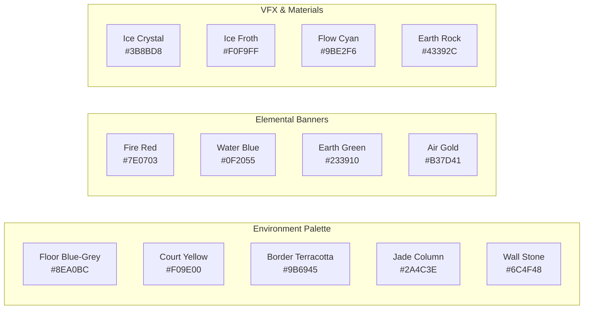
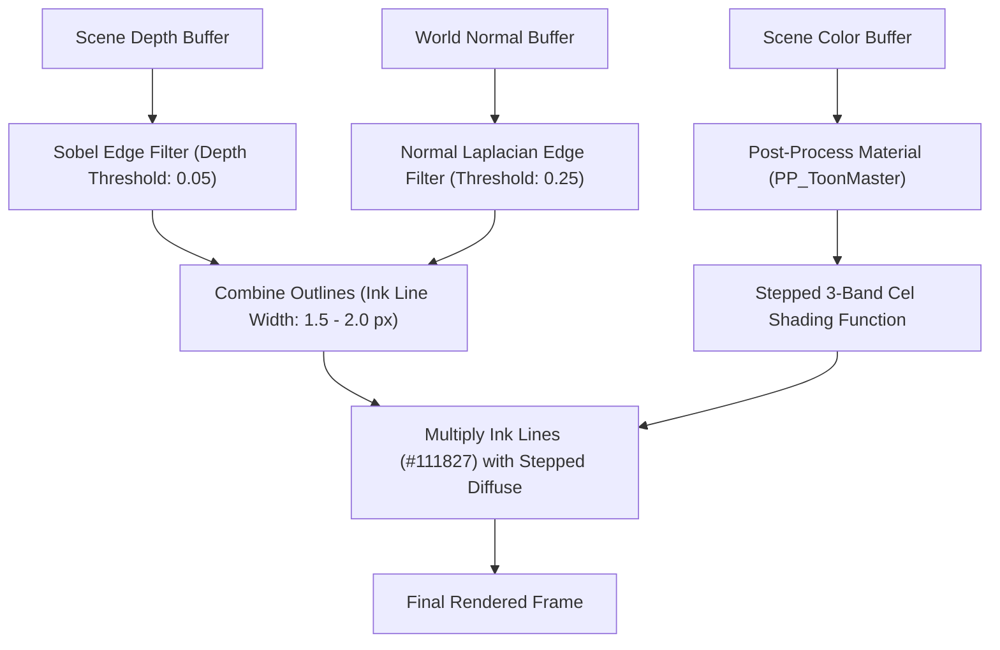
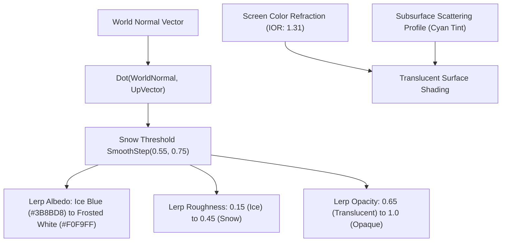

# 03 — Visual Art, Identical Color Palette & Shaders

## 1. Identical Color Palette Specification

To achieve 100% visual parity with the reference video, all assets, materials, shaders, and UI elements must strictly adhere to the sampled color palette below. These values were extracted directly from the video keyframes using pixel-level spectrophotometric sampling.



---

### Master Color Palette Table

| Role / Surface | Hex Code | RGB (0–255) | HSL | PBR / Shader Behavior |
| :--- | :--- | :--- | :--- | :--- |
| **Arena Floor (Outer Tiles)** | `#8EA0BC` | `(142, 160, 188)` | `(216°, 26%, 65%)` | Roughness: 0.65, Specular: 0.25, Subtle stone tile grid normal |
| **Arena Floor (Combat Court)**| `#F09E00` | `(240, 158, 0)` | `(40°, 100%, 47%)` | Roughness: 0.50, Specular: 0.35, Satin martial arts floor |
| **Arena Floor Perimeter Trim**| `#9B6945` | `(155, 105, 69)` | `(25°, 38%, 44%)` | Roughness: 0.75, Terracotta boundary step |
| **Colosseum Curved Walls** | `#6C4F48` | `(108, 79, 72)` | `(12°, 20%, 35%)` | Roughness: 0.85, Matte aged sandstone plaster |
| **Arena Columns / Pillars** | `#2A4C3E` | `(42, 76, 62)` | `(155°, 29%, 23%)` | Roughness: 0.40, Deep Imperial Jade stone |
| **Roof Overhang & Frames** | `#B37D41` | `(179, 125, 65)` | `(32°, 47%, 48%)` | Roughness: 0.55, Burnished gold-leaf lacquer wood |
| **Fire Banner** | `#7E0703` | `(126, 7, 3)` | `(2°, 95%, 25%)` | Fabric sheen, bright red flame crest (`#DC2626`) |
| **Water Banner** | `#0F2055` | `(15, 32, 85)` | `(225°, 70%, 20%)` | Fabric sheen, white cresting ocean wave (`#FFFFFF`) |
| **Earth Banner** | `#233910` | `(35, 57, 16)` | `(92°, 56%, 14%)` | Fabric sheen, pale green geometric mountain (`#86EFAC`) |
| **Air Banner** | `#B37D41` | `(179, 125, 65)` | `(32°, 47%, 48%)` | Fabric sheen, golden air spiral coil (`#FEF08A`) |
| **Ice Ramp (Core Body)** | `#3B8BD8` | `(59, 139, 216)` | `(209°, 67%, 54%)` | Translucent, IOR 1.31, Depth-faded internal scatter |
| **Ice Surface (Snow Top)** | `#F0F9FF` | `(240, 249, 255)` | `(204°, 100%, 97%)` | Roughness: 0.20, High albedo packed snow crust |
| **Water Whips / Chakrams** | `#38BDF8` | `(56, 189, 248)` | `(198°, 93%, 60%)` | Emissive ribbon particle, trailing splash sprites |
| **Flow Meter & UI Accents** | `#9BE2F6` | `(155, 226, 246)` | `(193°, 82%, 79%)` | Unlit emissive UMG / Slate brush shader |
| **Earth Stone Spires / Pillars**| `#43392C` | `(67, 57, 44)` | `(34°, 21%, 22%)` | Roughness: 0.90, Triplanar basalt/slate rock fracture |
| **Character Skin (Tanned)** | `#774825` | `(119, 72, 37)` | `(26°, 53%, 31%)` | 3-Tone Cel Shading: Shadow `#522B10`, Diffuse `#A06A42`, Light `#C08457` |
| **Waterbender Pants** | `#020D22` | `(2, 13, 34)` | `(219°, 89%, 7%)` | Midnight navy linen with cyan stitching |
| **Earthbender Pants** | `#233910` | `(35, 57, 16)` | `(92°, 56%, 14%)` | Olive drab martial arts silk/linen |
| **Skybox (Sunset Horizon)** | `#C8CEBD` to `#F97316` | Dynamic | Sunset Gradient | Warm peach-amber haze blending to pale cerulean blue |
| **Floating Damage Numbers** | `#FACC15` | `(250, 204, 21)` | `(48°, 96%, 53%)` | Pure yellow with black drop-shadow (`#000000`) |
| **Hitmarker 'X'** | `#FFFFFF` | `(255, 255, 255)` | `(0°, 0%, 100%)` | High-contrast white reticle flash |

---

## 2. Cel-Shading & Ink Outline Rendering Pipeline

The visual signature of *Flowbound* is characterized by crisp black ink outlines combined with multi-stepped diffuse toon shading reminiscent of anime martial arts illustrations.



### Outline Edge Detection Formula (Sobel Filter in HLSL)
```hlsl
// Unreal Engine Post-Process Material Custom HLSL Node
float2 TexelSize = View.ViewSizeAndInvSize.zw;
float DepthCenter = SceneTextureLookup(UV, 14, false).r;

// 4-tap Depth Gradient
float D_Up    = SceneTextureLookup(UV + float2(0, -TexelSize.y), 14, false).r;
float D_Down  = SceneTextureLookup(UV + float2(0,  TexelSize.y), 14, false).r;
float D_Left  = SceneTextureLookup(UV + float2(-TexelSize.x, 0), 14, false).r;
float D_Right = SceneTextureLookup(UV + float2( TexelSize.x, 0), 14, false).r;

float DepthDiff = abs(D_Up - D_Down) + abs(D_Left - D_Right);
float DepthEdge = saturate((DepthDiff / DepthCenter) * DepthSensitivity);

// 4-tap Normal Dot Gradient
float3 N_Center = SceneTextureLookup(UV, 8, false).rgb;
float3 N_Up     = SceneTextureLookup(UV + float2(0, -TexelSize.y), 8, false).rgb;
float3 N_Down   = SceneTextureLookup(UV + float2(0,  TexelSize.y), 8, false).rgb;
float3 N_Left   = SceneTextureLookup(UV + float2(-TexelSize.x, 0), 8, false).rgb;
float3 N_Right  = SceneTextureLookup(UV + float2( TexelSize.x, 0), 8, false).rgb;

float NormalDiff = (1.0 - dot(N_Up, N_Down)) + (1.0 - dot(N_Left, N_Right));
float NormalEdge = saturate(NormalDiff * NormalSensitivity);

float EdgeMask = saturate(DepthEdge + NormalEdge);
return lerp(float4(1,1,1,1), float4(0.07, 0.09, 0.15, 1.0), EdgeMask); // Dark ink outline
```

---

## 3. Procedural Ice Material Shader Architecture

The Ice Surf ramp and Ice Wall feature a unique dual-layer aesthetic:
1. **Internal Crystalline Core:** High translucency, light blue refraction (`#3B8BD8`), subsurface scattering, and interior diagonal fracture planes.
2. **Top Crust (Snow Layer):** Aligned with the World-Z normal vector (`Dot(WorldNormal, Vector(0,0,1)) > 0.65`), blending to opaque white frosted snow (`#F0F9FF`) with micro-sparkle glitter.



---

## 4. Lighting & Atmospheric Setup

- **Sun Directional Light:**
  - Color Temperature: 4800K (Warm golden hour amber `#FDBA74`).
  - Pitch: -32°, Yaw: 145° (Throws long, dramatic character shadows across the floor).
  - Cast Shadow Resolution: 4096 (Virtual Shadow Maps enabled for razor-sharp cel shadow edges).
- **Skylight:**
  - SLS Specified Cubemap: Sunset Colosseum HDR (Peach horizon, soft sky blue zenith).
  - Intensity: 1.25.
- **Atmospheric Fog:**
  - Exponential Height Fog with light scattering density: 0.02.
  - Inscattering color: `#FDBA74` at horizon, falloff: 0.15.
