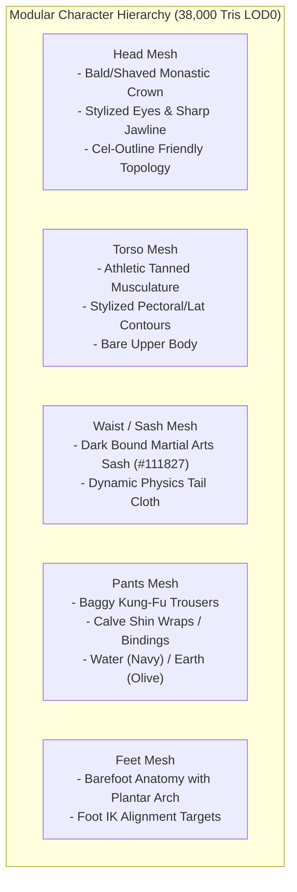
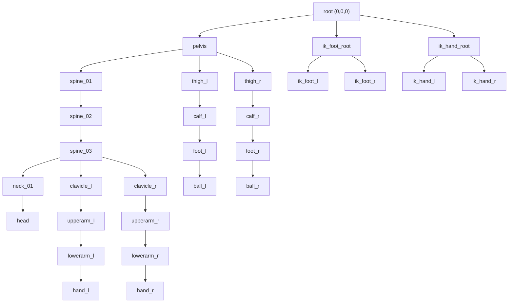
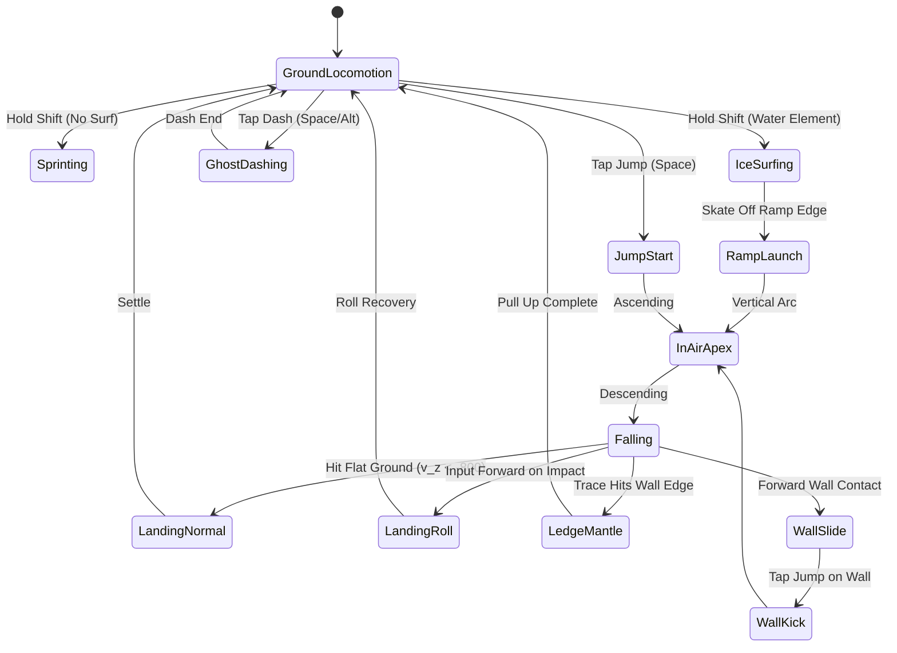
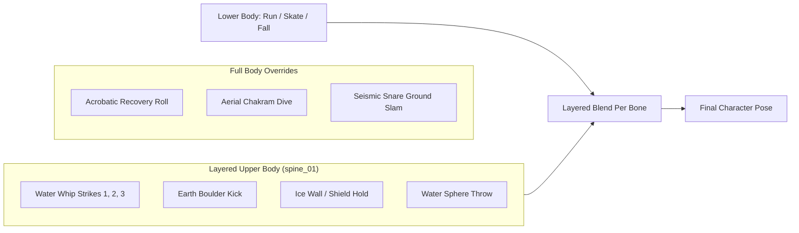

# 04 — Character Modeling & Animation Systems

## 1. 3D Character Model Specifications

The characters in *Flowbound* are stylized elemental martial artists inspired by Shaolin monks and traditional Wushu practitioners.

---

### Master Mesh & Asset Budget

| Component | Target Triangle Count | Texture Resolution | PBR Channels Used | Sockets / FX Anchors |
| :--- | :--- | :--- | :--- | :--- |
| **Head & Neck** | 6,500 tris | 2048 x 2048 | BaseColor, Normal, CelMask | `head_socket`, `eye_l`, `eye_r` |
| **Torso & Arms** | 12,000 tris | 2048 x 2048 | BaseColor, Normal, CelMask | `spine_03_socket`, `chest_fx` |
| **Hands (x2)** | 7,000 tris (3.5k each) | 2048 x 2048 | BaseColor, Normal, CelMask | `hand_l_fx`, `hand_r_fx` (Whip emitters) |
| **Trousers & Sash**| 9,500 tris | 2048 x 2048 | BaseColor, Normal, Roughness| `pelvis_socket`, `sash_tail` |
| **Legs & Bare Feet**| 5,000 tris | 2048 x 2048 | BaseColor, Normal, CelMask | `foot_l_fx`, `foot_r_fx` (Ice skate emitters)|
| **Total Character**| **40,000 tris** | **Shared 4K Atlas** | **High Efficiency Toon Pack**| **12 Rig Sockets** |

---

## 2. Rigging, Skeleton & IK Hierarchy

The skeletal structure is built on the standard Epic Unreal Humanoid hierarchy with additional helper and IK bones to support ice surfing and wall interactions.

### Essential Socket Attachments
- `hand_l_fx` & `hand_r_fx`: Spawns glowing water whips, water chakrams, or fire fist emitters.
- `foot_l_fx` & `foot_r_fx`: Emits snow/ice particles and dynamic surf decals.
- `root_ground_fx`: Projects the 2.8m ground aura ring during elemental stances.
- `spine_03_camera`: Anchor point for third-person spring-arm target offset.

---

## 3. Animation State Machine & Locomotion

### Locomotion Speed Profiles
- **Idle:** 0 cm/s (Wushu martial arts breathing stance).
- **Combat Walk:** 280 cm/s (Strafe enabled, upper body decoupled).
- **Run:** 620 cm/s.
- **Sprint:** 950 cm/s.
- **Ice Surfing:** 1,200 cm/s base acceleration, uncapped down slopes up to 1,650 cm/s.
- **Ghost Dash Velocity:** 1,800 cm/s burst over 0.25s duration.

---

## 4. Combat Animation Montages & Layering

Combat actions utilize an **Upper Body Montage Slot** layered over lower-body locomotion via a `Layered blend per bone` node starting at `spine_01`. This allows the character to run, skate, or leap while charging projectiles, throwing boulders, or casting shields.

---

## 5. Comprehensive Combat Frame Data Table

All timings assume a 60 FPS tickrate benchmark:

| Ability / Attack Name | Total Duration | Startup (Active Hits) | Active Frames | Recovery | On-Hit Advantage | Interruptible Cancel Window |
| :--- | :--- | :--- | :--- | :--- | :--- | :--- |
| **Water Whip 1 (`LMB`)** | 24 frames | 8 frames | 4 frames | 12 frames | +4 frames | Cancel recovery into Whip 2 at frame 13 |
| **Water Whip 2 (`LMB`)** | 28 frames | 10 frames | 4 frames | 14 frames | +6 frames | Cancel recovery into Whip 3 at frame 15 |
| **Water Whip 3 (Finisher)**| 38 frames | 14 frames | 6 frames | 18 frames | Knockdown | Non-cancelable finisher |
| **Water Chakrams (`RMB`)** | 36 frames | 12 frames | 8 frames | 16 frames | +2 frames | Cancel into Ghost Dash at frame 22 |
| **Aerial Chakram Dive** | 42 frames | 14 frames | 10 frames | 18 frames | Hard Knockdown| Can cancel on ground contact |
| **Ice Wall / Ramp (`Q`)** | 30 frames | 10 frames | Instant spawn | 20 frames | N/A | Cancel into Ice Surf at frame 12 |
| **Earth Boulder Kick (`LMB`)**| 46 frames | 18 frames | 8 frames | 20 frames | +8 frames (Stagger)| Cancel into Stone Guard at frame 28 |
| **Seismic Snare (`M4`)** | 52 frames | 20 frames | 12 frames | 20 frames | Launch / Float | Non-cancelable during stomp |
| **Ghost Dash** | 20 frames | 2 frames | 10 frames (i-frames)| 8 frames | Neutral | Cancel into any attack at frame 14 |
| **Ledge Mantle** | 24 frames | 4 frames | 16 frames | 4 frames | Neutral | Immediate attack on ledge crest |
