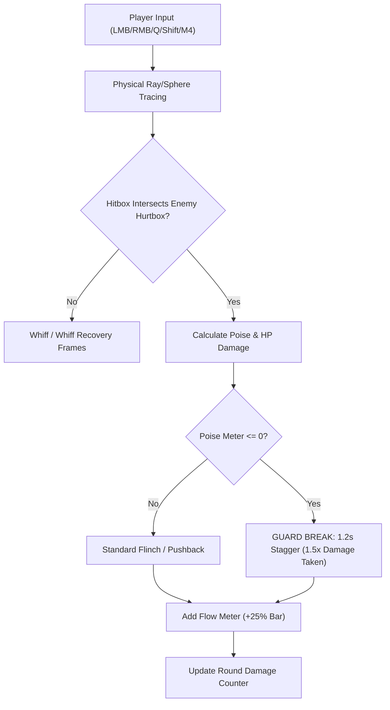
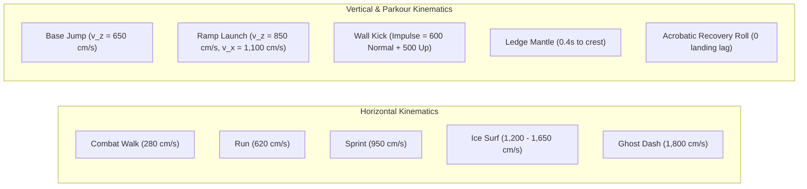
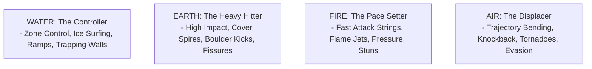
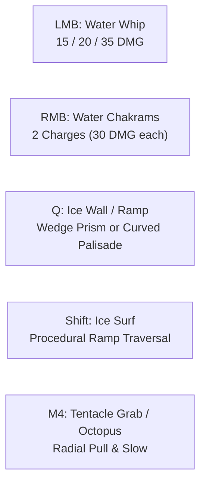
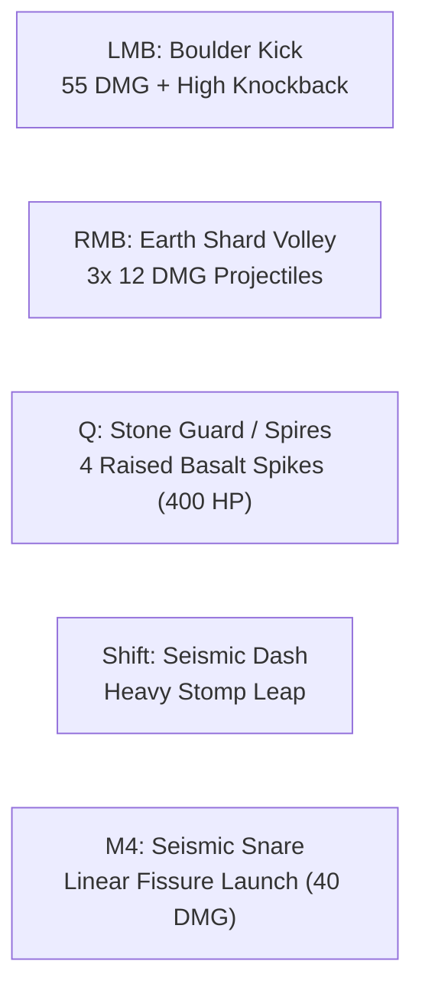
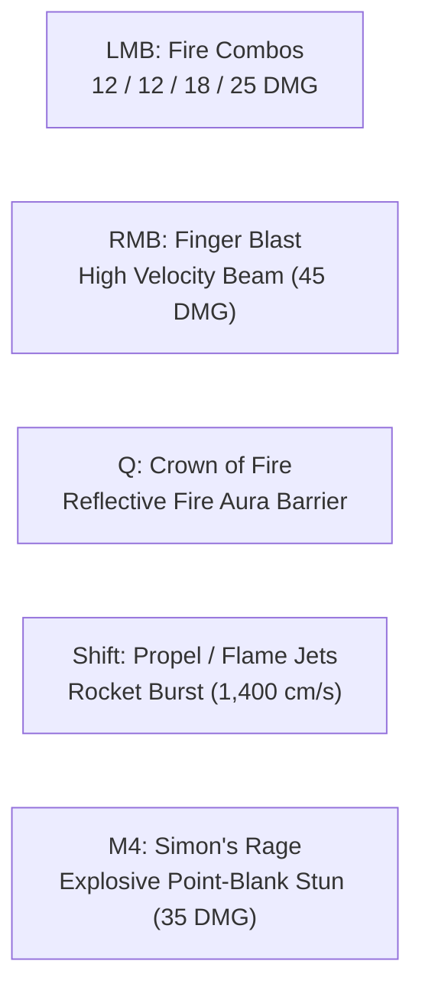
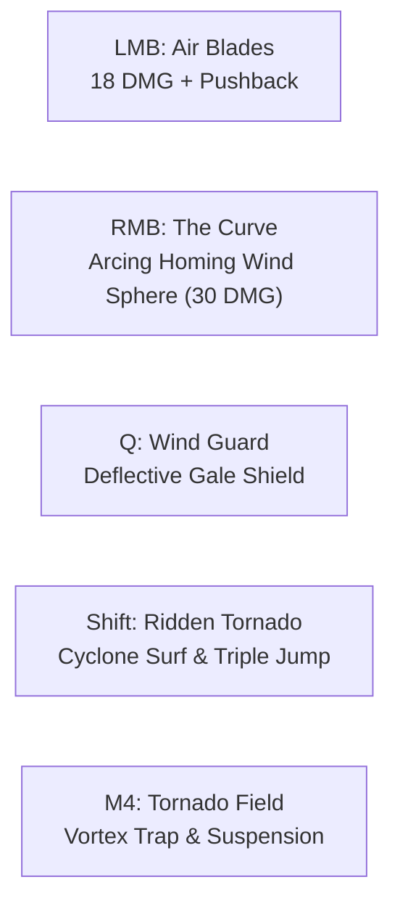

# 05 — Gameplay Mechanics & Combat Systems

## 1. Core Combat System & Mathematical Rules

Combat in *Flowbound* operates on strict real-time physical calculations, spatial zoning, and frame-advantage discipline. There are zero auto-lock or tab-targeting features; every attack is manually aimed via the center reticle.

---

### Core Resource Attributes

1. **Health Pool (HP): Exactly 150 Base HP**
   - Verified directly from the post-round recap screen: `150 Damage dealt = 1 KO`.
   - Overhead bar is divided by 6 tick markers (25 HP per interval).
   - Health does not automatically regenerate during an active round.
2. **Poise / Guard Meter: 100 Base Points**
   - Secondary white/grey bar located beneath the health bar.
   - Depleted by blocking attacks with barriers or receiving heavy blows.
   - **Guard Break:** When reduced to 0, player enters a staggered dazed state for 1.2 seconds (72 frames), during which all incoming attacks deal **1.5x critical damage** and trigger knockdown.
   - Poise regenerates after 2.5 seconds of not taking damage at a rate of 35 poise/second.
3. **Flow Meter: 3-Segment Electric Cyan Gauge (`#9BE2F6`)**
   - Located on the bottom-left HUD.
   - Used to cast advanced abilities, structural barriers, and ultimate extensions.
   - Charge accumulation:
     - Successful Melee / Projectile Hit: +25% segment.
     - Perfect Dodge / Ghost Dash through an attack: +35% segment.
     - Passive baseline flow: 1 segment per 15 seconds.

### Damage Calculation Formula
$$\text{NetDamage} = (\text{BaseDamage} \times \text{ZoneMultiplier} \times \text{StaggerMultiplier}) - \text{DamageReduction}$$

- **Zone Multiplier:**
  - Head / Vital Strike: $1.5\times$
  - Torso / Body: $1.0\times$
  - Limbs / Extremities: $0.85\times$
- **Stagger Multiplier:**
  - Standard State: $1.0\times$
  - Guard Broken / Airborne Float: $1.5\times$

---

## 2. Movement & Physics System

### Ice Surfing Extrusion Physics
When holding `Shift` with the Water discipline active:
1. Every 0.08 seconds (12.5 Hz), the player's world location and ground normal are sampled into a spline buffer.
2. A procedural triangle-wedge ribbon mesh (`UProceduralMeshComponent`) is extruded along the spline tangent.
3. The top surface friction coefficient is set to $\mu = 0.02$ (near-zero friction), accelerating the player downhill up to 1,650 cm/s.
4. **Ramp Launch Kinematics:** Skating off the apex of an angled ramp converts horizontal velocity into vertical lift:
   $$v_z = v_{\text{surf}} \cdot \sin(\theta), \quad v_x = v_{\text{surf}} \cdot \cos(\theta)$$
   At a 25° incline and 1,200 cm/s surf speed, $v_z = 507\text{ cm/s}$ and $v_x = 1087\text{ cm/s}$, producing an aerial jump arc reaching 3.8 meters in height.

---

## 3. The Four Elemental Disciplines: Full Ability Kits

---

### 💧 1. Water Discipline (The Controller)
*Observed in reference video used by `@whoiscobra`.*

1. **`LMB` — Water Whip (Primary Attack):**
   - Three-hit martial arts slash combo using twin water streams extended from wrists.
   - Damage: Hit 1 = 15 HP, Hit 2 = 20 HP, Hit 3 = 35 HP (Total: 70 HP).
   - Range: 6.5 meters. Hitbox: Sweeping horizontal and vertical arcs.
2. **`RMB` — Water Chakrams (Secondary / 2 Charges):**
   - Projects two spinning rings of compressed water. In air, initiates a downward homing dive strike.
   - Damage: 30 HP per chakram (60 total if both land).
   - Cooldown: 4.5 seconds per charge.
3. **`Q` — Ice Wall / Wedge Ramp (Barrier / Structure):**
   - Tap `Q`: Spawns right-triangular wedge ramp (6m length, 2.8m height) used for launching or blocking.
   - Hold `Q` + Flow: Spawns semicircular curved ice palisade trapping enemies in a 6m ring.
   - Health: 250 HP barrier pool. Lifespan: 8 seconds or until destroyed.
4. **`Shift` — Ice Surf (Mobility):**
   - Extrudes continuous ice path beneath feet. Consumes 8 stamina/second.
   - Speed: 1,200 – 1,650 cm/s.
5. **`M4` — The Octopus / Tentacle Grab (Crowd Control):**
   - Erupts 8 swirling water tentacles in a 5m radius around the character.
   - Damage: 25 HP. Pulls target 3m closer and inflicts a 40% slow for 1.5 seconds.

---

### ⛰️ 2. Earth Discipline (The Heavy Hitter)
*Observed in reference video used by `@pcnastyx`.*

1. **`LMB` — Boulder Kick (Primary Attack):**
   - Pulls a 1.2m stone sphere from the floor and kicks it forward with a roundhouse kick.
   - Damage: 55 HP. High poise damage (60 poise). Shatters enemy ice ramps on contact.
   - Range: 22 meters. Projectile speed: 28 m/s.
2. **`RMB` — Earth Shard Volley (Secondary):**
   - Rapidly fires 3 sharp stone spikes from fingertips in tight cone spread.
   - Damage: $3 \times 12 = 36\text{ HP}$.
   - Cooldown: 5.0 seconds.
3. **`Q` — Stone Guard / Earth Spires (Barrier / Structure):**
   - Stomps floor to erect 4 jagged basalt spires in a defensive curved wall.
   - Leaves negative space floor pits. Spires can be climbed, mantled, or jumped between.
   - Health: 400 HP barrier pool. Lifespan: 12 seconds.
4. **`Shift` — Seismic Dash / Earth Leap (Mobility):**
   - Launches forward in a low trajectory, crashing down with an earth tremor that knocks nearby enemies off balance.
5. **`M4` — Seismic Snare / Earth Fissure (Crowd Control):**
   - Powerful two-handed ground slam sending a linear shockwave fissure along the ground.
   - Damage: 40 HP. Erupts stone spikes under the target, launching them 4 meters into the air for juggle follow-up.

---

### 🔥 3. Fire Discipline (The Pace Setter)
*Designed to complete the 4-element roster with identical gameplay balance.*

1. **`LMB` — Fire Strikes (Primary Combo):** Fast 4-hit rapid punch/kick combo emitting flame arcs (12, 12, 18, 25 HP = 67 total).
2. **`RMB` — Finger Blast (Secondary):** Concentrated high-speed fire beam (velocity: 55 m/s) with 45 damage and burning damage-over-time.
3. **`Q` — Crown of Fire (Defensive):** Orbiting fire vortex shield that burns incoming projectiles and melts ice walls.
4. **`Shift` — Propel (Mobility):** Flame jets from hands and feet, launching forward or upward with omnidirectional thrust.
5. **`M4` — Simon's Rage (Crowd Control):** Point-blank 360-degree explosive fire blast that knocks enemies back and inflicts 0.8s stun.

---

### 🌪️ 4. Air Discipline (The Displacer)
*Designed to complete the 4-element roster with identical gameplay balance.*

1. **`LMB` — Air Palm / Blades (Primary):** Slices of compressed wind that deal 18 damage and apply moderate pushback.
2. **`RMB` — The Curve (Secondary):** Curved wind sphere that bends around physical barriers and earth pillars to strike targets in cover.
3. **`Q` — Wind Guard (Defensive):** Creates a swirling dome of wind that deflects physical projectiles (boulders, chakrams) back at attackers.
4. **`Shift` — Ridden Tornado / Air Flow (Mobility):** Spawns a miniature cyclone beneath the feet, allowing high-speed drifting and a triple air jump.
5. **`M4` — Tornado Field (Crowd Control):** Pulls enemies into a localized vortex, suspending them helpless in mid-air for 1.5 seconds.
