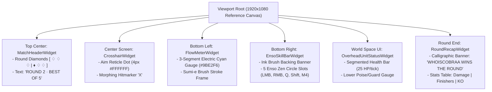
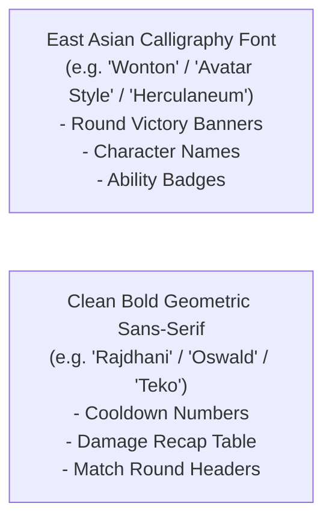

# 06 — UI, HUD & Audio System Specification

## 1. User Interface (UI) Architecture & Screen Hierarchy

The user interface of *Flowbound* marries modern competitive HUD clarity with traditional East Asian Sumi-e (ink brush) calligraphy aesthetics.

---

## 2. HUD Component Deep Breakdown

### A. Enso Skill Bar Widget (Bottom Right)
- **Primary Asset Link:** [ui_skill_bar.png](file:///D:/game%20dev/docs/screenshots/curated/ui_skill_bar.png)
- **Backing Graphic:** Horizontal Sumi-e black ink brush stroke (`#111827`, alpha 0.85) fading to soft frayed bristle edges on left and right.
- **Enso Circle Slots:** 5 circular icons encased in calligraphic brush-stroke Zen rings (Enso) with light blue / cyan glowing rims (`#9BE2F6`):
  1. **Slot 1 (`LMB`):** Solid inner circle with central aim dot. Default primary attack.
  2. **Slot 2 (`RMB`):** Dual arc rings with bold white numeric charge counter (`2`). Decrements on cast; refills sequentially on cooldown.
  3. **Slot 3 (`Q`):** Crenellated stone battlement / barrier icon (`Ice Wall` / `Stone Guard`).
  4. **Slot 4 (`Shift`):** Curling oceanic tidal wave / spiral icon (`Ice Surf` / `Air Flow`).
  5. **Slot 5 (`M4`):** Multiple vertical spiked lines / tentacles (`The Octopus` / `Seismic Snare`).
- **Cooldown Feedback:** 360-degree radial wipe (clockwise) with dark semi-transparent tint (`rgba(0,0,0,0.6)`), flashing white upon cooldown completion.

### B. Match Header Widget (Top Center)
- **Primary Asset Link:** [ui_match_header.png](file:///D:/game%20dev/docs/screenshots/curated/ui_match_header.png)
- **Container:** Dark slate-purple pill card (`rgba(30, 27, 46, 0.85)`), dimensions: 280 x 65 px, rounded corners (radius: 4px).
- **Round Win Pips:** 6 diamond indicators separated by a vertical white divider bar:
  - Left Team (3 diamonds): `♢ ♢ ♢` (Unfilled diamonds: `#94A3B8`).
  - Divider: Vertical white line (`#FFFFFF`, 2px width).
  - Right Team (3 diamonds): `♦ ♢ ♢` (Filled diamond: glowing cyan `#38BDF8`).
- **Round Title Text:** `ROUND 2 · BEST OF 5` in stylized uppercase gold lettering (`#E5D5BA`).

### C. Flow Meter Widget (Bottom Left)
- **Primary Asset Link:** [ui_flow_meter.png](file:///D:/game%20dev/docs/screenshots/curated/ui_flow_meter.png)
- **Container:** 3 contiguous horizontal rectangular segments (width: 60px each, height: 16px, 2px dark dividers).
- **Color:** Vibrant electric cyan (`#9BE2F6`) with subtle vertical light gradient.
- **Backing:** Textured black ink stroke running above the meter.

### D. Overhead Unit Health & Poise (World Space)
- **Primary Asset Link:** [ui_overhead_hp.png](file:///D:/game%20dev/docs/screenshots/curated/ui_overhead_hp.png)
- **Anchoring:** Projected in screen-space above the character's head via `UWidgetComponent`.
- **Top Health Bar:** 150 Total HP. Divided by 6 tick marks (25 HP each). White fill (`#FFFFFF`), smoothly interpolating red trailing ghost damage bar.
- **Bottom Poise Bar:** 100 Total Poise. Solid light grey fill (`#E2E8F0`), flashing yellow on low poise and shattering into red fragments on Guard Break.

### E. Post-Round Victory & Recap Scoreboard
- **Primary Asset Link:** [ui_recap_table.png](file:///D:/game%20dev/docs/screenshots/curated/ui_recap_table.png)
- **Victory Banner:** Horizontal dark slate banner spanning across the viewport:
  - Typography: `WHOISCOBRAA WINS THE ROUND` in large East Asian calligraphic brush display font (`#BAE6FD`).
- **Recap Table:**
  - Header: `ROUND 2 RECAP - BEST OF THE ROUND: WHOISCOBRAA` in gold text (`#F59E0B`).
  - Table Columns: `DAMAGE` | `FINISHERS` | `KO`
  - Row 1: `~ WHOISCOBRAA (YOU)` | `150` | `2` | `1`
  - Row 2: `- TIKTOK PCNASTYX` | `145` | `0` | `0`

---

## 3. Typography & Font Specifications

---

## 4. Comprehensive Sound Design (SFX) Matrix

| Sound Category | Sound Event Name | Audio Characteristics / Layers | Foley & Synthesis Sources |
| :--- | :--- | :--- | :--- |
| **Locomotion** | `SFX_Footstep_Tile` | Crisp bare skin slap on polished stone | Barefoot studio foley on tile |
| **Locomotion** | `SFX_Footstep_Sand` | Low grit scuff on arena dirt | Crushed gravel and fine sand |
| **Ice Surfing**| `SFX_Ice_Surf_Loop` | Continuous sharp ice skate slicing with rushing mountain wind | Ice blade scraping frozen lake + white noise filter |
| **Ice Surfing**| `SFX_Ramp_Launch` | Sudden whoosh transition with crystalline chime | Whip crack + glass resonance pitch up |
| **Water Combat**| `SFX_Water_Whip_Swing`| High-speed hydraulic lash crack | Wet leather bullwhip + water hose burst |
| **Water Combat**| `SFX_Water_Chakram_Throw`| Whirring spinning buzz saw of water | Circular blade spinning + liquid bubbling |
| **Water Combat**| `SFX_Ice_Wall_Spawn`| Rapid tectonic freezing and fracturing | Cracking glacier ice sheet + deep bass thump |
| **Earth Combat**| `SFX_Earth_Stomp` | Massive low-frequency sub-bass shockwave | 40Hz sine drop + granite slab dropping |
| **Earth Combat**| `SFX_Boulder_Kick` | Heavy stone thud transitioning to whistling flight | Sledgehammer hitting boulder + mortar whoosh |
| **Earth Combat**| `SFX_Spire_Erupt` | Grinding rock friction and stone eruption | Tectonic rumbling + stone quarry collapse |
| **UI & Feedback**| `SFX_Hitmarker_Tick` | High-frequency mechanical crisp click (confirmed hit) | Metallic shutter click (`4.2 kHz`) |
| **UI & Feedback**| `SFX_Guard_Break` | High-impact glass shattering and ringing bell | Smashed tempered glass + Tibetan singing bowl |
| **UI & Feedback**| `SFX_Round_Victory` | Resonant Taiko drum roll and triumphant brass horn | Deep Japanese Taiko + cinematic horn swell |
