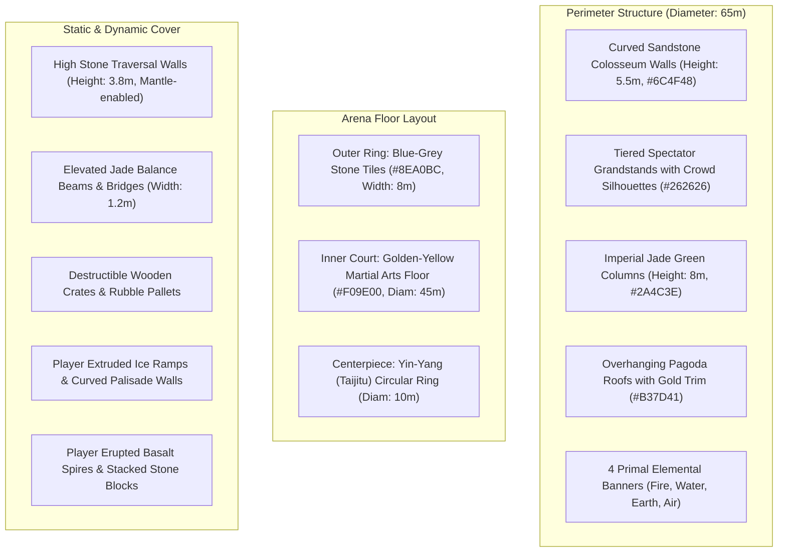
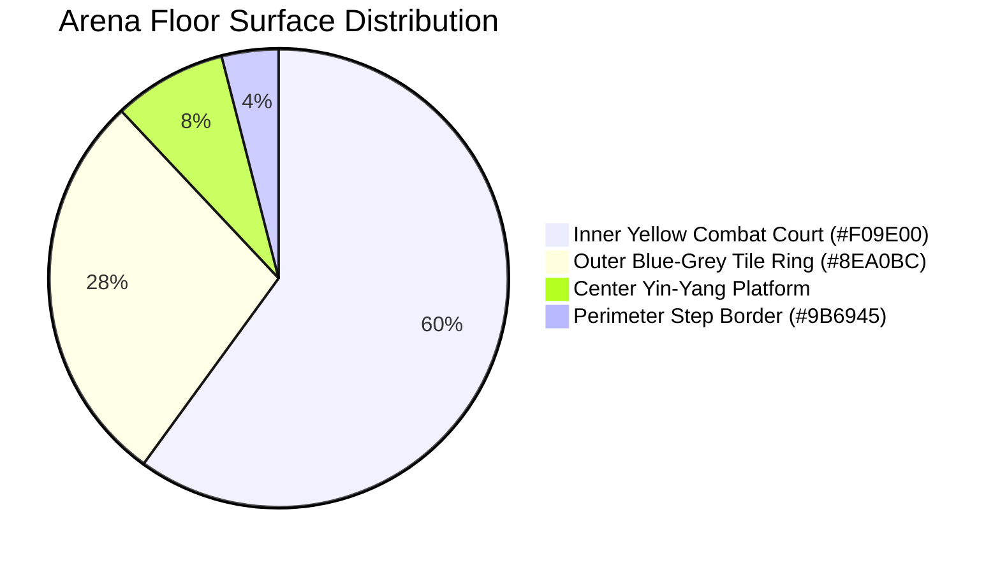

# 07 — Environment & Level Design Specification

## 1. Arena Architecture & Spatial Blueprint

The battleground featured in the reference video is the **Elemental Colosseum**—a grand amphitheater purpose-built for martial arts tournaments and elemental combat.



---

## 2. Floor Zoning & Ground Decal Plan



1. **Inner Yellow Combat Court (`#F09E00`):**
   - 45-meter diameter octagon/circle.
   - Smooth satin finish with painted white and yellow court boundary lines.
   - High visibility surface designed to make dark characters and glowing elemental projectiles instantly readable.
2. **Outer Blue-Grey Tile Ring (`#8EA0BC`):**
   - 8-meter wide perimeter apron featuring clean rectangular tile paving.
   - Serves as the high-speed ice-skating ring where players build momentum before cutting inward.
3. **Center Yin-Yang (Taijitu) Ring:**
   - 10-meter diameter circular decal embedded in the exact center of the arena floor.
   - Traditional Taoist martial arts symbol representing balance between elements.
4. **Negative Space Earth Pits:**
   - Whenever an Earthbender summons a stone spire or boulder, the floor beneath it dynamically opens into an excavated pit (`#1E1B18`) with jagged edge geometry, showing where the rock was torn from the earth.

---

## 3. Structural Cover & Traversal Features

```mermaid
flowchart LR
    Ground["Arena Floor Level (0.0m)"]
    
    Ground -->|Mantle (0.4s)| MidWall["Mid Wall Platform (+3.8m)<br>- High Ground Sniping<br>- Balance Beam Connectors"]
    Ground -->|Ice Surf Launch| HighAir["Airborne Arc (+5.0m to +7.0m)<br>- Aerial Chakram Dive<br>- Wall Kick Traversal"]
    
    MidWall -->|Drop / Slide| Ground
    HighAir -->|Ground Slam| Ground
```

### Static Obstacle Inventory
- **Mid-Height Traversal Walls:** 3.8m tall sandstone walls. Top surface is 1.2m wide, wide enough for full locomotion, sprint jumping, and projectile casting.
- **Jade Green Columns:** Massive octagonal pillars (`#2A4C3E`) that provide total line-of-sight blockage against heavy projectiles like boulders and water chakrams.
- **Elevated Balance Beams:** Horizontal jade lintels connecting pillars, enabling cross-arena traversal without touching the floor.
- **Destructible Wooden Crates:** Groupings of wooden cargo boxes. Taking 20+ damage shatters them into physical debris that scatters and despawns after 4 seconds.

---

## 4. Collision Layers & Boundary Volumes

| Volume Name | Collision Profile | Physics Behavior | Tag / Gameplay Function |
| :--- | :--- | :--- | :--- |
| **Arena_Floor_Plane** | `BlockAll` | Flat walkable plane, dynamic decal receiver | `Surface.Walkable`, `Surface.Tile` |
| **Colosseum_Outer_Wall**| `BlockAll` | Vertical cylindrical collision (height: 12m) | `Surface.WallRun`, `Surface.Climbable`|
| **Arena_Ceiling_Blocker**| `BlockAll` | Invisible ceiling barrier at +15.0m | Prevents out-of-bounds flight |
| **Kill_Z_Boundary** | `OverlapAll` | Set at -10.0m below arena floor | Instant KO if player falls through holes|
| **NavMeshBoundsVolume** | N/A | Dynamic generation around all walls/ice | Generates pathfinding mesh for AI bots |
