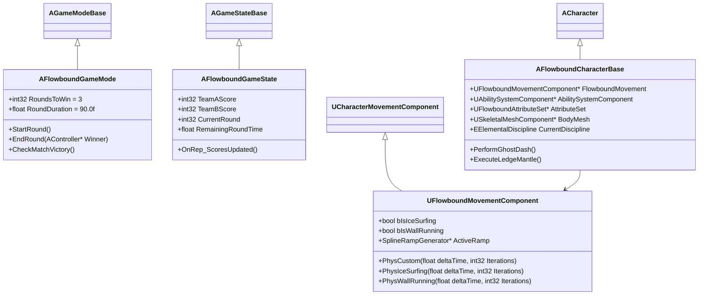
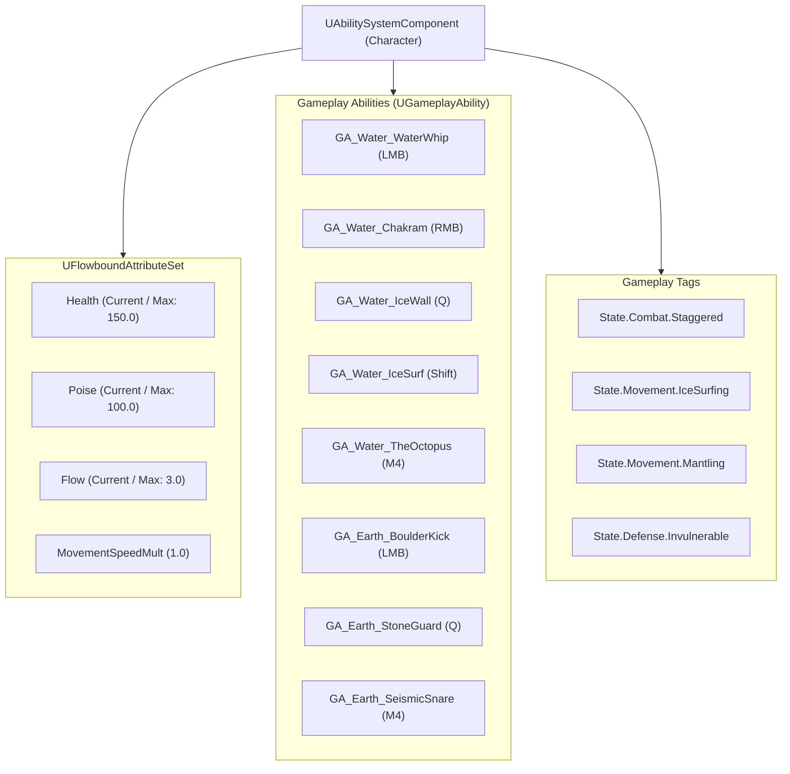
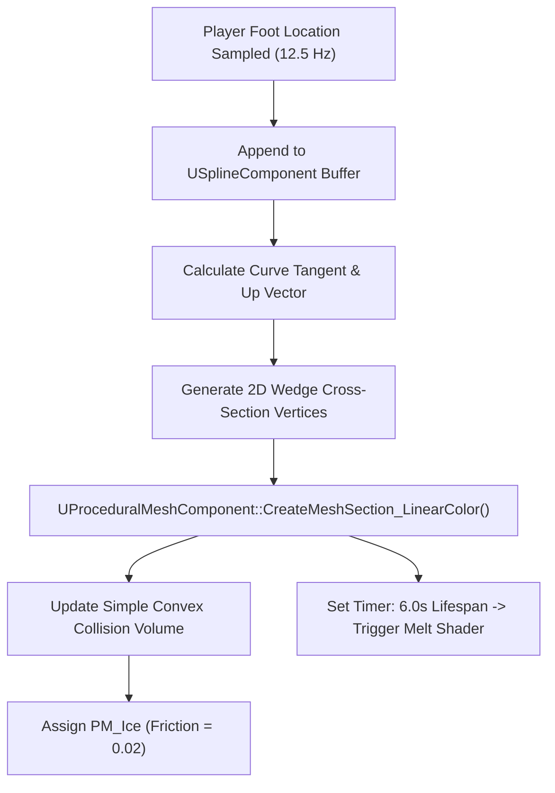
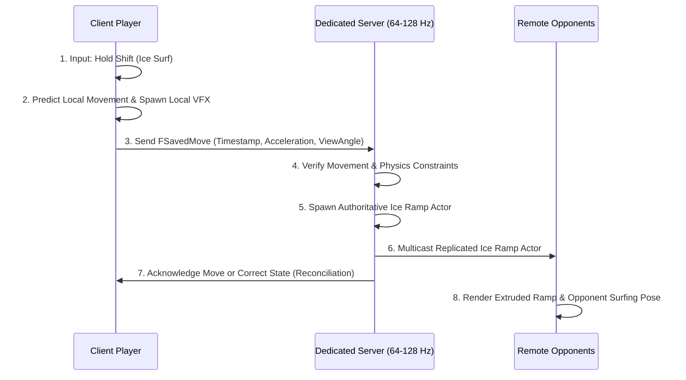

# 08 — Game Architecture & Technical Stack

## 1. Engine Architecture & Core Class Hierarchy

The architecture of *Flowbound* is implemented in **Unreal Engine 5.4+** utilizing modern C++ design patterns, the **Gameplay Ability System (GAS)**, and custom **Enhanced Input** mappings.



---

## 2. Gameplay Ability System (GAS) & Attribute Set

All character abilities, status effects, cooldowns, and resources are governed through Unreal Engine's **Gameplay Ability System**.



### Attribute Set Definition (C++ Header Spec)
```cpp
UCLASS()
class FLOWBOUND_API UFlowboundAttributeSet : public UAttributeSet
{
    GENERATED_BODY()

public:
    UPROPERTY(BlueprintReadOnly, ReplicatedUsing = OnRep_Health, Category = "Attributes|Health")
    FGameplayAttributeData Health;
    ATTRIBUTE_ACCESSORS(UFlowboundAttributeSet, Health)

    UPROPERTY(BlueprintReadOnly, ReplicatedUsing = OnRep_MaxHealth, Category = "Attributes|Health")
    FGameplayAttributeData MaxHealth;
    ATTRIBUTE_ACCESSORS(UFlowboundAttributeSet, MaxHealth)

    UPROPERTY(BlueprintReadOnly, ReplicatedUsing = OnRep_Poise, Category = "Attributes|Poise")
    FGameplayAttributeData Poise;
    ATTRIBUTE_ACCESSORS(UFlowboundAttributeSet, Poise)

    UPROPERTY(BlueprintReadOnly, ReplicatedUsing = OnRep_Flow, Category = "Attributes|Flow")
    FGameplayAttributeData Flow;
    ATTRIBUTE_ACCESSORS(UFlowboundAttributeSet, Flow)

    virtual void PreAttributeChange(const FGameplayAttribute& Attribute, float& NewValue) override;
    virtual void PostGameplayEffectExecute(const FGameplayEffectModCallbackData& Data) override;
};
```

---

## 3. Real-Time Procedural Ice Spline Extrusion

The iconic Ice Surfing mechanic requires dynamically generating 3D geometry with convex physical collision in real time behind the player.



### Procedural Mesh Generation Algorithm
```cpp
void AIceRampActor::AddSplinePointAndExtrude(const FVector& NewPoint, const FVector& ForwardDir)
{
    SplineComponent->AddSplinePoint(NewPoint, ESplineCoordinateSpace::World);
    int32 PointIndex = SplineComponent->GetNumberOfSplinePoints() - 1;

    if (PointIndex < 2) return;

    FVector CurrentPos = SplineComponent->GetLocationAtSplinePoint(PointIndex - 1, ESplineCoordinateSpace::World);
    FVector NextPos = SplineComponent->GetLocationAtSplinePoint(PointIndex, ESplineCoordinateSpace::World);
    FVector RightDir = FVector::CrossProduct(ForwardDir, FVector::UpVector).GetSafeNormal();

    float HalfWidth = 110.0f; // 2.2m total width
    float Height = 35.0f;     // Wedge slab thickness

    // Generate 4-vertex quad per segment
    int32 BaseIdx = Vertices.Num();
    Vertices.Add(CurrentPos - RightDir * HalfWidth);
    Vertices.Add(CurrentPos + RightDir * HalfWidth);
    Vertices.Add(NextPos - RightDir * HalfWidth);
    Vertices.Add(NextPos + RightDir * HalfWidth);

    // Triangles
    Triangles.Add(BaseIdx + 0); Triangles.Add(BaseIdx + 2); Triangles.Add(BaseIdx + 1);
    Triangles.Add(BaseIdx + 1); Triangles.Add(BaseIdx + 2); Triangles.Add(BaseIdx + 3);

    ProceduralMesh->CreateMeshSection_LinearColor(SectionIndex++, Vertices, Triangles, Normals, UV0, Colors, Tangents, true);
}
```

---

## 4. Multiplayer Replication & Client-Side Prediction

*Flowbound* is engineered for competitive online multiplayer with strict server authority and smooth client responsiveness.



### Network Synchronization Targets
- **Tickrate:** 64 Hz baseline (up to 128 Hz dedicated competitive instances).
- **Lag Compensation:** Circular history buffer (500ms) storing bounding capsule transforms for server-side raycast rewinding during high-velocity projectile hits.
- **Interpolation:** Remote proxies interpolate at 60 Hz with cubic Hermite spline position smoothing.
