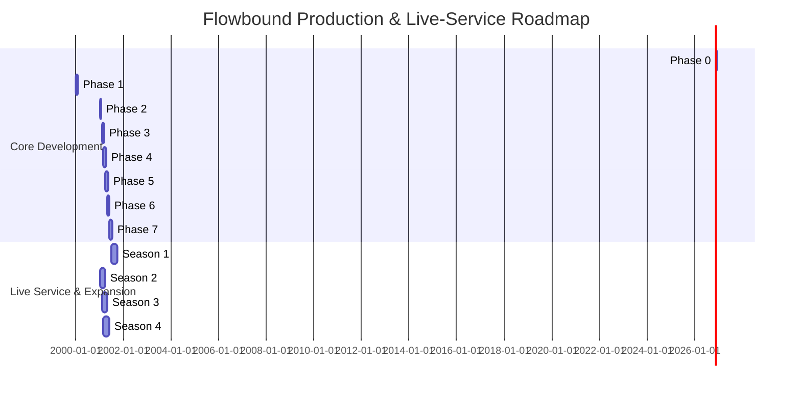
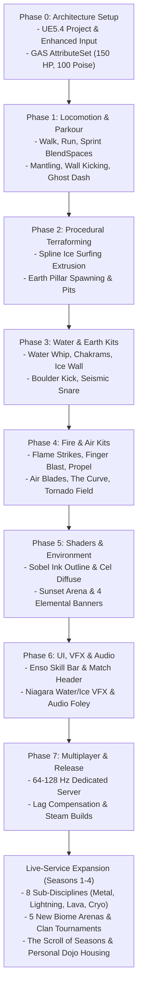
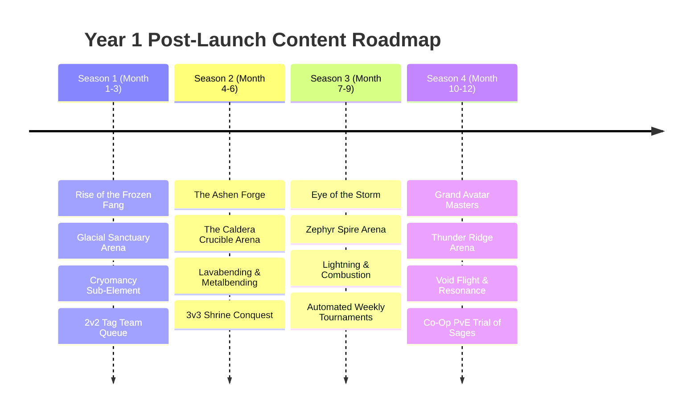

# 09 — Production Plan, Phased Roadmap & Live-Service Expansion

## 1. Production Strategy & Engineering Philosophy

To recreate *Flowbound: Masters of Four* with identical mechanical feel, visual style, and network stability, development is structured into **8 core production phases** followed by a **4-season Live-Service Roadmap**. 

Each phase establishes a verifiable, playable milestone. Coding and asset production follow a strict dependency chain: **Physics & Movement First $\rightarrow$ Combat Framework $\rightarrow$ Procedural Terraforming $\rightarrow$ Visual Shaders $\rightarrow$ UI/Audio Polish $\rightarrow$ Network Hardening $\rightarrow$ Live Operations**.

---

## 2. Phase-by-Phase Breakdown & Deliverables

---

### Core Development Phases (Weeks 1–36)

- **Phase 0: Engine Setup & Architecture Foundation (Weeks 1–3):** UE5.4 project scaffolding, C++ GameMode, GameState, PlayerController, Enhanced Input mappings, and GAS AttributeSet (150 HP, 100 Poise, 3 Flow).
- **Phase 1: Character Locomotion & Parkour Physics (Weeks 4–7):** 8-way directional locomotion, 3.8m ledge mantling, wall running, wall kicks, acrobatic landing roll, and Ghost Dash with white afterimage.
- **Phase 2: Procedural Traversal & Terraforming (Weeks 8–11):** Real-time procedural spline mesh extrusion for Ice Surfing, low-friction physics ($\mu = 0.02$), launch ramp kinematics, earth spire summoning with negative-space floor cavities.
- **Phase 3: Core Combat Framework & First Roster Pair (Weeks 12–16):** Manual aiming ray/sphere sweep hit detection, poise damage, 1.2s Guard Break, and complete playable **Water** and **Earth** kits.
- **Phase 4: Remaining Elemental Roster (Fire & Air) (Weeks 17–21):** Fast-paced **Fire** (flame combos, Finger Blast, Propel) and **Air** (air blades, The Curve, Wind Guard, Ridden Tornado, Tornado Field).
- **Phase 5: Cel-Shading, Shaders & Environment Assets (Weeks 22–26):** Sobel edge ink outline post-process, multi-band stepped diffuse, IOR 1.31 ice shader, 65m Colosseum arena with dual-zone floor (`#8EA0BC` and `#F09E00`), Yin-Yang center ring, and 4 elemental banners.
- **Phase 6: UI, HUD, Audio & Visual Polish (Weeks 27–30):** Enso calligraphic skill bar, slate match header with diamond pips, overhead segmented health bars, hitmarker `X`, post-round recap scoreboard, Niagara particle VFX, and full audio foley suite.
- **Phase 7: Multiplayer Replication, Steam QA & Launch (Weeks 31–36):** Dedicated 64–128 Hz servers, 500ms lag compensation rewind buffers, matchmaking, Steam integration, and 120 FPS performance profiling.

---

## 3. Live-Service Expansion Roadmap (Year 1)

Following the 1.0 base release, *Flowbound* expands into an enduring competitive ecosystem with quarterly seasonal drops:

---

### Season 1: *Rise of the Frozen Fang* (Months 1–3)
- **New Arena:** **Glacial Sanctuary** (Lake ice skating surfaces, breakable thin ice crevasses, alpine temple).
- **Sub-Disciplines Introduced:** **Cryomancy** (Permafrost freeze stacks, ice spike traps) and **Mist Phase** (Vapor illusions, decoy clones).
- **New Master:** **Master Kaelen** (Water/Cryomancy - Tai Chi style).
- **New Game Mode:** **Tag Team 2v2 Ranked Queue** with cross-elemental synergies.
- **Battle Pass:** 100-Tier *Scroll of the Frozen Fang*.

---

### Season 2: *The Ashen Forge* (Months 4–6)
- **New Arena:** **The Caldera Crucible** (Basalt stepping stones, erupting magma geysers, thermal updrafts).
- **Sub-Disciplines Introduced:** **Metalbending** (Magnetic wire tethers, iron armor) and **Lavabending** (Molten slag pools, volcanic tremors).
- **New Masters:** **Master Zhu** (Earth/Metal - Hung Gar style) and **Master Orok** (Earth/Lava - Bokh style).
- **New Game Mode:** **Shrine of the Four (3v3 Objective Conquest)** with terraforming fortifications.
- **Feature:** Personal Martial Arts Dojo housing customization.

---

### Season 3: *Eye of the Storm* (Months 7–9)
- **New Arena:** **Zephyr Spire** (Floating sky pagodas, crosswind corridors, bottomless void drops).
- **Sub-Disciplines Introduced:** **Lightning Generation** (Hitscan electric bolts, lightning redirection) and **Combustion** (Third-eye explosive sniping).
- **New Masters:** **Master Azari** (Fire/Lightning - Northern Shaolin style) and **Master Ren** (Fire/Combustion - Muay Thai style).
- **New Feature:** **Automated In-Game Weekly Dojo Tournaments** with 32-player brackets and live spectator broadcast.
- **Feature:** Replay Theater with frame-by-frame scrubbing and hitbox/hurtbox debug overlays.

---

### Season 4: *Grand Avatar Masters* (Months 10–12)
- **New Arena:** **Thunder Ridge Monastery** (Conductor copper spires, electrified ice ramp paths).
- **Sub-Disciplines Introduced:** **Void Flight** (Zero-G weightlessness, vacuum dome) and **Sound Resonance** (Harmonic concussive shockwaves).
- **New Masters:** **Master Tenzin** (Air/Resonance - Bagua style) and **Master Zephyra** (Air/Void - Wing Chun style).
- **New Game Mode:** **Trial of the Sages (1-4 Player Co-Op PvE Horde)** with 20 waves of corrupted shadow spirits and roguelike elemental boons.
- **Esports Milestone:** The Inaugural *Flowbound World Championship* Invitational Tournament.
