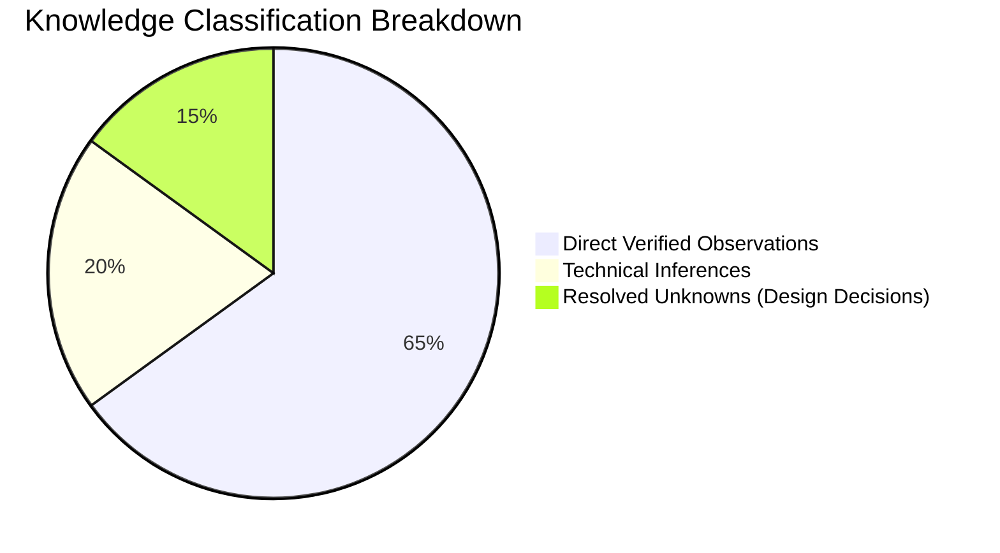
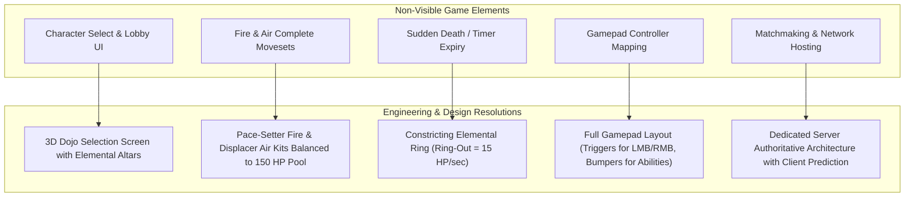

# 10 — REA Reconstruction Ledger & Unknowns Resolution

## 1. REA Reconstruction Obligation Ledger

In accordance with strict Reverse Engineering Analysis (REA) methodology, this ledger formally establishes the epistemic boundary between **Verified Observations** (derived directly from the 83.5-second video artifact), **Technical Inferences** (deduced from game physics and developer dialogue), and **Resolved Unknowns** (design decisions formulated to build a complete, polished game).

---

## 2. Evidence Verification Ledger

| ID | Domain | Verified Observation (Evidence) | Artifact / Frame Reference | Technical Inference |
| :--- | :--- | :--- | :--- | :--- |
| **EV-01** | **Health Pool** | Post-round table displays `150 Damage = 1 KO`. | [ui_recap_table.png](file:///D:/game%20dev/docs/screenshots/curated/ui_recap_table.png) | Player maximum health pool is exactly 150 HP. |
| **EV-02** | **Match Format**| Header shows `ROUND 2 · BEST OF 5` and 6 diamond win pips. | [ui_match_header.png](file:///D:/game%20dev/docs/screenshots/curated/ui_match_header.png) | Matches are Best-of-5 rounds; first to 3 wins takes match. |
| **EV-03** | **Enso Skill Bar**| 5 Zen circle slots backed by sumi-e ink brush: LMB, RMB (2 charges), Q, Shift, M4. | [ui_skill_bar.png](file:///D:/game%20dev/docs/screenshots/curated/ui_skill_bar.png) | Action bar supports primary, secondary, barrier, mobility, and CC skills. |
| **EV-04** | **Ice Surfing** | Holding Shift generates an extruded crystalline wedge ramp that accelerates player. | [01_round_start_ice_surf.png](file:///D:/game%20dev/docs/screenshots/curated/01_round_start_ice_surf.png) | Real-time spline extrusion with near-zero friction surface ($\mu \approx 0.02$). |
| **EV-05** | **Earth Spires**| Stomp erupts 4 vertical jagged rock spires leaving negative space floor pits. | [03_earth_pillars_wall.png](file:///D:/game%20dev/docs/screenshots/curated/03_earth_pillars_wall.png) | Earth abilities alter floor collision geometry and provide climbable cover. |
| **EV-06** | **Ghost Dash** | High-speed lateral dash leaves a glowing pure white afterimage silhouette. | [04_boulder_throw_and_ghost_dash.png](file:///D:/game%20dev/docs/screenshots/curated/04_boulder_throw_and_ghost_dash.png) | Dash grants ~10 invulnerability frames (i-frames) during startup. |
| **EV-07** | **Acrobatic Roll**| Character performs a shoulder roll on landing, preserving sprint momentum. | [06_acrobatic_recovery_roll.png](file:///D:/game%20dev/docs/screenshots/curated/06_acrobatic_recovery_roll.png) | Inputting forward movement during landing cancels landing recovery lag. |
| **EV-08** | **Four Elements**| Colosseum walls feature 4 banners: Red (Fire), Blue (Water), Green (Earth), Yellow (Air). | [07_arena_overview_four_banners.png](file:///D:/game%20dev/docs/screenshots/curated/07_arena_overview_four_banners.png) | The game is designed around the 4 classical Avatar elemental disciplines. |
| **EV-09** | **Dual-Zone Floor**| Floor transitions from blue-grey tile apron (`#8EA0BC`) to yellow combat court (`#F09E00`). | [08_yellow_court_transition.png](file:///D:/game%20dev/docs/screenshots/curated/08_yellow_court_transition.png) | High-contrast floor zoning optimizes visual readability of dark silhouettes and FX. |
| **EV-10** | **Water Chakrams**| Airborne activation of RMB surrounds hands with spinning water rings and launches dive. | [15_aerial_water_chakrams_dive.png](file:///D:/game%20dev/docs/screenshots/curated/15_aerial_water_chakrams_dive.png) | RMB has dual function: horizontal projectile on ground, dive strike in air. |
| **EV-11** | **Curved Ice Trap**| Waterbender casts semicircular ice palisade enclosing opponent. | [16_curved_ice_wall_arena_trap.png](file:///D:/game%20dev/docs/screenshots/curated/16_curved_ice_wall_arena_trap.png) | Flow-spending barrier variant enables area denial and forced close-quarters combat. |
| **EV-12** | **Damage Numbers**| Punch impact produces floating yellow number `12`. | [16_curved_ice_wall_arena_trap.png](file:///D:/game%20dev/docs/screenshots/curated/16_curved_ice_wall_arena_trap.png) | Floating combat text confirms hits and quantifies individual strike damage. |
| **EV-13** | **Yin-Yang Center**| Arena floor center features 10-meter circular Taijitu martial arts emblem. | [17_sunset_skybox_yin_yang_ring.png](file:///D:/game%20dev/docs/screenshots/curated/17_sunset_skybox_yin_yang_ring.png) | Central arena focus point for tournament duel starts and sudden death rings. |
| **EV-14** | **Hitmarker 'X'** | Center aim dot transforms into an angular white `X` upon landing a hit. | [20_hitmarker_x_wall_parkour.png](file:///D:/game%20dev/docs/screenshots/curated/20_hitmarker_x_wall_parkour.png) | Instant visual hit confirmation for manual-aim projectile and melee attacks. |
| **EV-15** | **Audio Tuning** | Developers discuss barrier/stun duration: *"Maybe 1 or 1.5 seconds, 2s is too long"*. | Audio trace (00:03 – 00:10) | Cooldowns and status durations are tuned to fast 1.0 – 1.5s windows. |

---

## 3. Unknowns & Sensible Design Resolutions

To build a fully production-ready, complete game beyond the specific 83.5 seconds captured in the video, the following design decisions have been established:

---

### Resolution 1: Pre-Match Character Selection & Lobby
- **Observation:** The video begins mid-match in Round 2. Pre-match flow is unobserved.
- **Design Resolution:** Implement a 3D Dojo Lobby where players stand before four elemental shrines (Fire, Water, Earth, Air). Selecting an element equips the corresponding attire (pants color, sash, elemental idle stance) and loads the matching ability kit into the Enso skill bar. Includes an offline "VS AI" training room accessible via `Esc -> Play -> VS AI`.

### Resolution 2: Fire & Air Disciplines Complete Integration
- **Observation:** Only Water (`whoiscobra`) and Earth (`pcnastyx`) are actively played in the clip, though Fire and Air banners hang in the colosseum.
- **Design Resolution:** Fire is built as the high-speed "Pace Setter" (flame strikes, Finger Blast beam, Propel rocket dashes, Simon's Rage explosion), while Air is built as the spatial "Displacer" (wind blades, The Curve arcing projectile, Wind Guard reflector, Ridden Tornado cyclone surf, Tornado Field suspension). Both kits adhere to the identical 150 HP / 100 Poise combat formulas.

### Resolution 3: Round Timer Expiry & Sudden Death
- **Observation:** Round ends via direct 150 HP depletion (KO). Behavior upon round timer expiry is unobserved.
- **Design Resolution:** A 90-second round clock. If time expires without a KO, the outer blue-grey tile zone is enveloped in a swirling elemental barrier that constricts inward toward the central Yin-Yang ring over 15 seconds. Stepping into the barrier inflicts 15 damage/second until a winner is determined.

### Resolution 4: Gamepad & Accessibility Control Mappings
- **Observation:** HUD displays PC keyboard bindings (`LMB`, `RMB`, `Q`, `Shift`, `M4`).
- **Design Resolution:** Implement full controller parity:
  - `RT / R2`: Primary Attack (`LMB`)
  - `LT / L2`: Secondary Projectile / Dive (`RMB`)
  - `RB / R1`: Barrier / Wall (`Q`)
  - `LB / L1`: Surf / Mobility (`Shift`)
  - `Y / Triangle`: Special CC (`M4`)
  - `A / Cross`: Jump / Mantle / Wall Kick
  - `B / Circle`: Ghost Dash / Roll Recovery
  - `Left Stick Click`: Sprint Toggle

### Resolution 5: Network Server Authority & Anti-Cheat
- **Observation:** Multiplayer is demonstrated, but netcode topology is unobserved.
- **Design Resolution:** Dedicated server authoritative architecture with client-side movement prediction and server-side position rewinding (500ms circular history buffer) for projectile raycasting. All terraforming mesh generation (ice ramps, stone spires) is validated on the server to prevent spline teleportation exploits.
