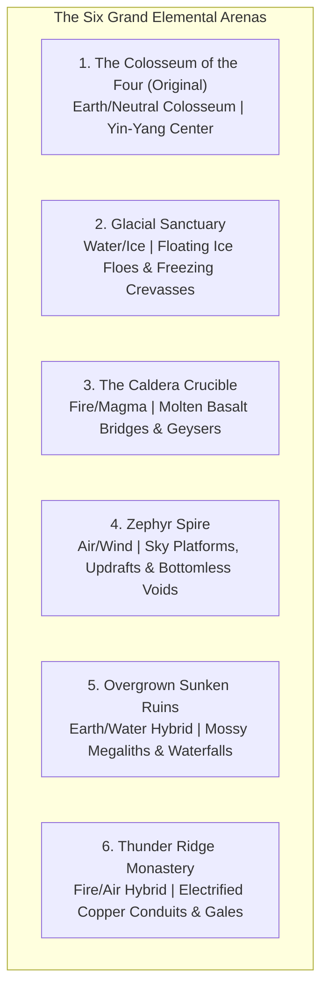
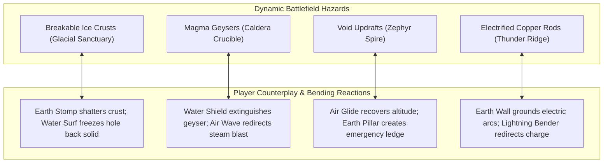

# 11 — Expanded Arenas & Environmental Hazards

## 1. Architectural Philosophy: The Living Elemental World

In *Flowbound*, arenas are not static backdrops—they are active participants in combat. Every arena embodies one of the primal disciplines or a volatile border where two elements clash.

Each arena introduces **unique terraforming affordances**, **dynamic weather/lighting shifts**, and **skill-testing hazards** that reward mastery of spatial control, momentum, and elemental physics while preserving 100% of the game's cel-shaded East Asian aesthetic.

---

## 2. Comprehensive Arena Catalog & Mechanics

### Arena 1: The Colosseum of the Four (Canonical Reference Stage)
- **Primary Element:** Neutral / Tournament Ground.
- **Visual Identity:** Aged sandstone colosseum walls (`#6C4F48`), jade columns (`#2A4C3E`), gold pagoda trim (`#B37D41`), vibrant yellow combat court (`#F09E00`), and four monumental discipline banners.
- **Environmental Hazard:**
  - **Dynamic Collapsing Tier Columns:** Dealing 300+ structural damage to corner columns causes the upper pagoda beam to collapse into walkable ramp rubble.
- **Sudden Death:** Overhanging roof bells chime as a contracting elemental boundary shrinks toward the center Yin-Yang ring after 90 seconds.

---

### Arena 2: Glacial Sanctuary (Water / Ice Biome)
- **Theme:** An ancient frozen temple perched atop a sub-zero alpine mountain glacier.
- **Visual Palette:**
  - Deep Glacier Ice: `#0369A1` / `#0284C7` (High refraction, sub-surface glow).
  - Packed Snow Fields: `#F0F9FF` / `#E0F2FE` (Footstep compression decals).
  - Frosted Temple Timber: `#1E293B` with crystalline icicle trim.
- **Unique Mechanics & Traversal:**
  - **Natural Ice Skating Zones:** 40% of the arena floor consists of natural lake ice where all elements gain an automatic +25% sprint acceleration and low-friction sliding.
  - **Breakable Ice Crusts:** Certain floor plates have structural cracks. Hitting them with heavy attacks (e.g. Earth Boulder Kick or Meteor Slam) shatters the crust, revealing an icy water crevasse beneath. Falling in inflicts 25 cold damage and expels the player upward in an ice geyser.
  - **Sub-Zero Blizzard Event (Round 3+):** Ambient freezing mist reduces far sightlines and coats all raised earth walls with slippery ice crusts.

---

### Arena 3: The Caldera Crucible (Fire / Magma Biome)
- **Theme:** A volcanic fortress built within the mouth of an active shield volcano.
- **Visual Palette:**
  - Black Basalt Rock: `#18181B` / `#09090B` (Craggy volcanic stone with orange edge fissures).
  - Molten Lava Surge: `#EA580C` to `#EF4444` (Emissive HDR pulse, glowing embers).
  - Brass Braziers: `#D97706` (Smoky atmospheric distortion).
- **Unique Mechanics & Traversal:**
  - **Basalt Magma Stepping Stones:** Hexagonal basalt columns rise and fall in the magma sea on a 15-second tectonic cycle.
  - **Lava Geysers:** Intermittent steam/lava vents marked by bubbling floor cracks. Standing on an active vent launches the player 8 meters into the air but deals 15 burning damage unless blocked by a shield.
  - **Thermal Updrafts:** Firebenders using `Propel` and Airbenders using `Ridden Tornado` gain +50% vertical boost when navigating above lava channels.

---

### Arena 4: Zephyr Spire (Air / Wind Biome)
- **Theme:** A floating monastery suspended high in the clouds held aloft by ancient wind vortexes.
- **Visual Palette:**
  - White Marble Pagodas: `#F8FAFC` with teal-glazed ceramic roof tiles (`#0D9488`).
  - Cloudscape Horizon: Ethereal golden sunset clouds (`#FED7AA` to `#F472B6`).
  - Wind Stream Ribbons: Translucent white turbulence spirals (`#FFFFFF`, alpha 0.4).
- **Unique Mechanics & Traversal:**
  - **Ring-Out / Void Hazards:** The arena perimeter has no walls; stepping or being knocked off the edge triggers a bottomless fall. Players who fall off are caught by swirling gale updrafts that launch them back onto the stage while inflicting 35 falling damage and resetting their poise to 0.
  - **Persistent Crosswinds:** Directional wind currents shift every round, curving horizontal projectiles (Water Chakrams, Fire Beams, Air Blades) slightly along the wind vector unless perfectly countered.
  - **Floating Stepping Stones:** Weight-sensitive stone platforms that tilt and lower when stood upon for longer than 3.0 seconds.

---

### Arena 5: Overgrown Sunken Ruins (Earth / Water Hybrid)
- **Theme:** A drowned stone city overgrown with giant banyan tree roots, cascading waterfalls, and sacred moss.
- **Visual Palette:**
  - Mossy Ancient Masonry: `#3F6212` / `#4D7C0F` over weathered grey limestone (`#64748B`).
  - Crystal Clear Pools: Shallow knee-deep water (`#38BDF8`, depth: 0.3m).
  - Sunken Gold Relics: Weathered bronze statues (`#78350F`).
- **Unique Mechanics & Traversal:**
  - **Shallow Water Puddles:** Waterbenders consume 50% less Flow when casting Ice Surfing or Water Whips while standing in the water pools.
  - **Living Root Mantles:** Enormous tree roots serve as natural half-pipes and curved ramps that any player can wall-run across.
  - **Mud Slide Slopes:** Steep muddy inclines that accelerate sliding characters into super-sprints.

---

### Arena 6: Thunder Ridge Monastery (Fire / Air Hybrid)
- **Theme:** A mountaintop sanctuary struck continuously by lightning storms, fitted with colossal copper rods and conductive chains.
- **Visual Palette:**
  - Storm Dark Clouds: Violent indigo-violet tempest sky (`#1E1B4B` to `#312E81`).
  - Weathered Copper Metal: Verdigris turquoise patina (`#0D9488`) with polished brass edges.
  - Electric Arc Flash: Neon violet and electric cyan lightning strikes (`#A855F7` / `#00F0FF`).
- **Unique Mechanics & Traversal:**
  - **Lightning Conductor Rods:** Towering copper spires attract lightning strikes every 20 seconds. Players within 4 meters of a rod when it discharges take 20 electric shock damage and are briefly stunned (0.6s).
  - **Electrified Water Paths:** If a Waterbender creates an ice ramp that touches a charged copper rod, the ice glows purple and electrifies anyone standing on it.

---

## 3. Dynamic Hazard Matrix & Tactical Interactions

| Arena | Primary Hazard | Damage / Effect | Counterplay / Synergistic Interaction |
| :--- | :--- | :--- | :--- |
| **Colosseum of the Four** | Collapsing Pagoda Beams | 40 Crush DMG + Rubble | Dodge roll away; creates new permanent ramp cover |
| **Glacial Sanctuary** | Thin Ice Pit Crevasses | 25 Cold DMG + Slow | Waterbenders can re-freeze the surface instantly |
| **The Caldera Crucible** | Erupting Magma Geysers | 15 Burn DMG + High Launch | Block with Ice Shield to trigger steam smoke screen |
| **Zephyr Spire** | Bottomless Void Drop | 35 Fall DMG + Poise Break | Air recovery jump or mantle onto floating stones |
| **Overgrown Ruins** | Sinking Mud Swamps | -35% Movement Speed | Ice Surf skates directly across mud without penalty |
| **Thunder Ridge** | Conductive Lightning Rods | 20 Shock DMG + 0.6s Stun | Raise an Earth Wall between character and the rod |
