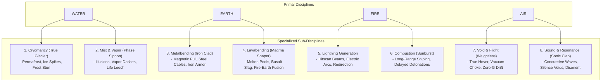
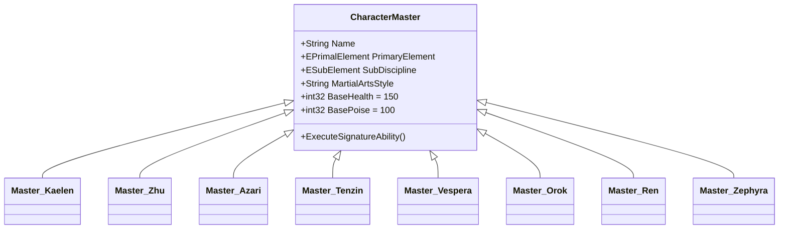

# 12 — Sub-Elements & Advanced Character Roster

## 1. Lore-Rooted Sub-Elements & Advanced Disciplines

To evolve *Flowbound* from an indie demo into a world-class competitive franchise, the elemental framework expands into **eight authentic sub-disciplines**. 

Sub-elements do not replace the core 4 elements; rather, they serve as specialized branches that players unlock through elemental mastery or character selection, adding asymmetric playstyles without breaking combat balance.

---

## 2. Sub-Element Mechanical Specifications

### 1. Water Sub-Disciplines
- **Cryomancy (Glacier Mastery):**
  - **Signature Mechanic — Permafrost Coating:** Attacking enemies coats them in crystalline frost stacks (1 stack = 5% slow). At 5 stacks, the target is **Flash Frozen** for 1.0 second, during which blunt impacts deal +30% shatter damage.
  - **Glacial Spike Trap:** Converts player ice ramps into jagged defensive spike beds that damage enemies who attempt to skate or climb them.
- **Mist & Vapor (Phase Siphon):**
  - **Signature Mechanic — Vapor Form:** Dodging (`Shift`) turns the character into an ethereal cloud of water vapor for 0.4 seconds, passing through physical obstacles, boulders, and enemy attacks.
  - **Vapor Decoy:** Spawns a mist duplicate that mimics the player's last input; striking the decoy explodes it into a blinding water plume.

### 2. Earth Sub-Disciplines
- **Metalbending (Iron Clad):**
  - **Signature Mechanic — Magnetic Wire Tether:** Fires high-tensile steel cables from wrist bracers, tethering to stone pillars, walls, or opponents. Allows Spider-Man-style high-speed pendulum swings and aggressive grapple-pull kicks.
  - **Iron Armor Plating:** Rips iron plates from the earth onto the character's limbs, granting 40 temporary armor HP and complete immunity to light flinch.
- **Lavabending (Magma Shaper):**
  - **Signature Mechanic — Molten Crucible:** Rips stone from the earth and superheats it into glowing molten lava. Lavabend projectiles leave burning magma pools on the arena floor that deal 18 fire damage/second to anyone walking through them.
  - **Basalt Wall Solidification:** Lava walls cool into brittle dark basalt after 4 seconds; striking them shatters them into shrapnel.

### 3. Fire Sub-Disciplines
- **Lightning Generation & Redirection:**
  - **Signature Mechanic — Hitscan Bolt (`RMB` Charge):** After a 0.6s charge animation with dual-finger circular drawing, fires a near-instant hitscan lightning bolt (velocity: 250 m/s) dealing 50 damage and interrupting enemy casts.
  - **Lightning Catch & Redirection:** Tapping `Q` with precise 3-frame timing when struck by enemy lightning or energy absorbs the charge through the arms and redirects it toward the crosshair.
- **Combustion (Sunburst Sniping):**
  - **Signature Mechanic — Mind Eye Focus:** Enters an over-the-shoulder scope mode, aiming a high-precision third-eye laser reticle. Releasing fires a supersonic beam that causes an enormous 4-meter explosion on impact (65 damage, 80 poise damage).

### 4. Air Sub-Disciplines
- **Void & Weightlessness (True Flight):**
  - **Signature Mechanic — Kinetic Hover:** Double tapping `Space` engages true 3D flight for up to 5 seconds, allowing unrestricted omnidirectional aerial mobility and aerial dive bombing.
  - **Vacuum Dome:** Expels all air in a 5-meter sphere around an enemy, depleting their stamina instantly and disabling elemental casting for 1.2 seconds.
- **Sound & Resonance (Sonic Concussion):**
  - **Signature Mechanic — Thunder Clap:** Martial double-palm strike that produces a deafening directional shockwave (`Cone 60°`), ringing the opponent's ears (muffles in-game audio) and blurring their camera with chromatic aberration.

---

## 3. The Grand Masters Roster (Playable Characters)

---

### Master Profile 1: Master Kaelen — The Crystalline Frost
- **Discipline:** Water / Cryomancy.
- **Visual Silhouette:** Tall, athletic Northern monk wearing deep indigo tunic (`#1E1B4B`), frosted fur trims, and crystalline ice bracers.
- **Martial Arts Basis:** **Tai Chi Chuan** (Slow, flowing circular movements suddenly erupting into explosive snap force).
- **Signature Ability:** *Glacial Spear Barrage* — Summons 6 levitating ice javelins that fire sequentially at the reticle.

### Master Profile 2: Master Zhu — The Iron Mountain
- **Discipline:** Earth / Metalbending.
- **Visual Silhouette:** Muscular, broad-shouldered powerhouse wearing heavy slate-green pants (`#233910`), blackened iron forearm rings, and bare scarred chest.
- **Martial Arts Basis:** **Hung Gar** (Low, rock-solid horse stances, devastating downward elbow strikes, and ferocious tiger claw palms).
- **Signature Ability:** *Iron Tether Grapple* — Hooks into the nearest wall or enemy, propelling himself at 2,000 cm/s into a flying knee strike.

### Master Profile 3: Master Azari — The Azure Tempest
- **Discipline:** Fire / Lightning.
- **Visual Silhouette:** Lean, razor-sharp duelist in high-collared crimson robes (`#7E0703`) with gold dragon embroidery and twin flame daggers.
- **Martial Arts Basis:** **Northern Shaolin** (High kicks, acrobatic spinning sweeps, leaping aerial maneuvers).
- **Signature Ability:** *Heaven's Piercing Arc* — Releases a bifurcated blue-white lightning bolt that chains between closely grouped opponents.

### Master Profile 4: Master Tenzin — The Wandering Gale
- **Discipline:** Air / Sound & Resonance.
- **Visual Silhouette:** Weathered elderly master with sweeping white eyebrows, flowing saffron and terracotta robes (`#D97706`), carrying prayer beads.
- **Martial Arts Basis:** **Baguazhang** (Intricate circle-walking, evasive palm changes, never standing still, fluid counter-spinning).
- **Signature Ability:** *Harmonic Resonance Palm* — Emits a concussive chime wave that shatters enemy rock walls and reflects incoming projectiles.

### Master Profile 5: Master Vespera — The Shadow Mist
- **Discipline:** Water / Mist & Phase.
- **Visual Silhouette:** Mysterious, agile female monk wearing flowing midnight-black silk wraps (`#0F172A`) and a sheer face veil with glowing cyan eyes.
- **Martial Arts Basis:** **Capoeira / Baguazhang hybrid** (Rhythmic deceptive footwork, low-to-the-ground cartwheels, unexpected sweeping kicks).
- **Signature Ability:** *Mist Mirage* — Dissolves into vapor, instantly swapping positions with a target within 15 meters and disorienting their camera.

### Master Profile 6: Master Orok — The Molten Colossus
- **Discipline:** Earth / Lavabending.
- **Visual Silhouette:** Enormous imposing figure wearing volcanic basalt plate armor and shoulder pauldron glowing with internal orange magma veins.
- **Martial Arts Basis:** **Bokh (Mongolian Wrestling) & Sumo** (Crushing body tackles, ground sweeps, unyielding forward momentum).
- **Signature Ability:** *Caldera Tremor* — Slams the ground with both fists, converting a 10-meter circle of arena floor into churning liquid lava.

### Master Profile 7: Master Ren — The Solar Flare
- **Discipline:** Fire / Combustion.
- **Visual Silhouette:** Austere ascetic monk with a glowing solar crest tattooed onto his forehead and wrapped linen arm wraps.
- **Martial Arts Basis:** **Muay Thai** (Crushing shin kicks, clinches, devastating direct knee thrusts).
- **Signature Ability:** *Nova Beam* — Concentrates solar chi into a pinpoint beam from the third eye, detonating with a 4-meter shockwave upon impact.

### Master Profile 8: Master Zephyra — The Weightless Sky
- **Discipline:** Air / Void Flight.
- **Visual Silhouette:** Graceful, ethereal female acrobat wearing gossamer sky-blue ribbons (`#38BDF8`) that flutter continuously in an invisible personal updraft.
- **Martial Arts Basis:** **Wing Chun & Contemporary Wushu** (Ultra-fast center-line punches, effortless aerial spins, weightless leaps).
- **Signature Ability:** *Zero-G Singularity* — Creates an anti-gravity vortex in mid-air that traps all nearby combatants in a zero-friction suspension zone.
