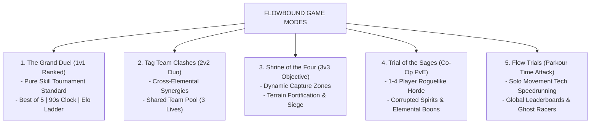
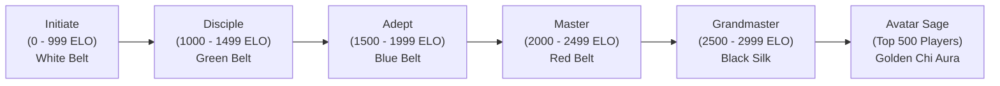
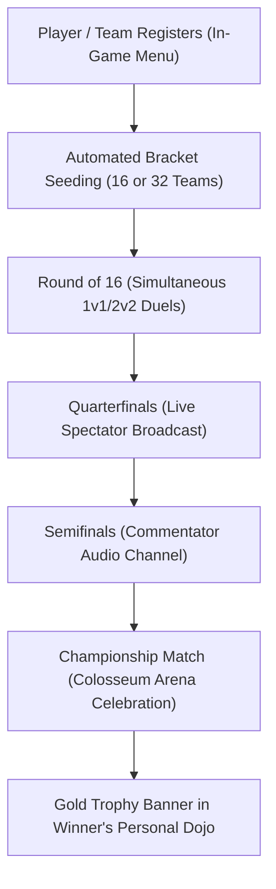

# 13 — Game Modes, Ranked Tiers & Tournament Systems

## 1. Multi-Tiered Game Mode Ecosystem

To cater to both hardcore competitive esports players and casual community gamers, *Flowbound* is architected around five distinct game modes designed to maximize replayability.

---

## 2. Comprehensive Game Mode Blueprints

### Mode 1: The Grand Duel (1v1 Ranked / Tournament Standard)
- **Format:** 1v1, Best-of-5 rounds.
- **Round Timer:** 90 seconds. If time expires, the outer arena ring dissolves into a constricting elemental void over 15 seconds, forcing players onto the central Yin-Yang ring.
- **Ruleset:**
  - Identical baseline attributes (150 HP, 100 Poise, 3 Flow Bars).
  - No stat-altering equipment or pay-to-win items.
  - Winner receives Elo rating points and Ranked Dojo Prestige.

### Mode 2: Tag Team Clashes (2v2 Duo Arena)
- **Format:** 2v2 simultaneous free-form arena combat.
- **Win Condition:** First team to achieve 3 total knockouts wins the match.
- **Core Synergistic Mechanics:**
  - **Elemental Resonance:** Standing within 6 meters of an ally grants +10% stamina regeneration and triggers **Dual Elemental Cross-Combos** (e.g. Water player generates an ice ramp that the Earth player launches boulders off with +50% kinetic speed).
  - **Revival Defibrillation:** When a teammate's HP hits 0, they enter a 12-second downed state. An ally can stand over them for 3.0 seconds to channel elemental life chi, reviving them with 45 HP (usable once per match).

### Mode 3: Shrine of the Four (3v3 Objective Control)
- **Format:** 3v3 team conquest across large arenas (e.g. *Overgrown Sunken Ruins*).
- **Objective:** Three ancient shrines (Water, Fire, Earth) are distributed across the arena:
  - Capturing a shrine requires standing uncontested within its 6-meter stone circle for 5 seconds.
  - Controlling shrines generates 1 Chi Point per second per shrine. First team to reach 500 Chi Points wins.
- **Terraforming Siege Playstyle:**
  - Players actively use their elemental bending to fortify and siege capture points. Waterbenders erect ice walls around the shrine capture zone; Earthbenders construct raised stone spires to block enemy sightlines; Airbenders summon vortexes to push defenders out of the circle.

### Mode 4: Trial of the Sages (1–4 Player Co-Op PvE Horde)
- **Format:** 1 to 4 players cooperate to defend the sacred Temple of Elements against 20 escalating waves of corrupted shadow spirits and gargantuan bosses.
- **Enemy Roster:**
  - *Shadow Claws:* Fast swarm melee beasts that crawl along walls.
  - *Magma Golems:* Heavy armored brutes that throw molten boulders.
  - *Tempest Wraiths:* Flying specters that fire homing wind scythes.
  - *Wave 10 & 20 Bosses:* Corrupted Elemental Avatars wielding dual elements simultaneously.
- **Roguelike Boon Upgrades (Between Waves):**
  - Players choose 1 of 3 elemental blessings after clearing each wave (e.g. *"Frostbite: Ice Surf leaves behind freeze caltrops"*, *"Volcanic Core: Boulder kicks explode on impact for 25 AoE burn"*, *"Wind Sheer: Ghost Dash deflects projectiles"*).

### Mode 5: Flow Trials (Parkour & Speedrun Time-Trials)
- **Format:** Solo obstacle courses through floating ruins, razor-sharp canyons, and cascading river arches.
- **Objective:** Complete the course from start gate to finish arch in the fastest possible time.
- **Scoring:** Graded on Gold, Silver, and Bronze medal brackets based on mastery of momentum conservation:
  - Chaining ice ramp launches into wall kicks.
  - Utilizing recovery rolls to cancel fall lag.
  - Bunny-hopping across weight-sensitive stepping stones.
- **Competitive Features:** Replays saved to global leaderboards with asynchronous **Ghost Racer Visualizations** showing the world record player's path in real time.

---

## 3. Competitive Ranked Hierarchy & Tier System

Ranked matches use a modified Glicko-2 competitive rating algorithm with clear visual ranks inspired by ancient martial arts martial ranking:

- **Placement Matches:** 5 placement matches at the start of each competitive season to determine starting tier.
- **Rank Decay:** Master tier and above experience slight rating decay after 7 days of inactivity to ensure active ladder competition.
- **Seasonal Rewards:** Exclusive calligraphic weapon wraps, custom Enso HUD glowing rings, and elemental titles (e.g. *"Grandmaster of the Frozen Deep"*, *"Sage of the Ashen Peak"*).

---

## 4. In-Game Automated Tournaments & Replay Theater

### In-Game Replay Theater & Cinematic Director Mode
1. **Full Deterministic Replays:** Every ranked and tournament match is saved as a lightweight telemetry file (< 5 MB) storing input packets, positions, and physics seeds.
2. **Scrubbing & Slow Motion:** Fast-forward, rewind, and slow down to 0.1x speed for deep combat analysis.
3. **Debug Visualizers:** Toggle on/off real-time display of **Hitboxes** (red spheres/capsules), **Hurtboxes** (green skeletal bones), and **Invulnerability Frame Highlights** (white mesh highlights).
4. **Cinematic Free-Cam:** Detach the camera with drone smoothing, customizable FOV, depth of field blur, and hide-HUD mode for community creators to capture cinematic montages and machinimas.
