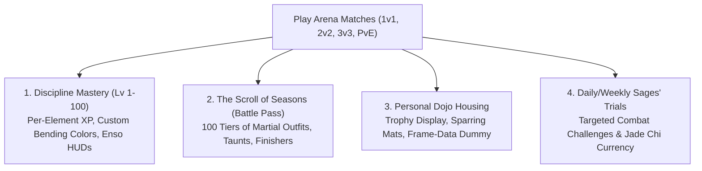
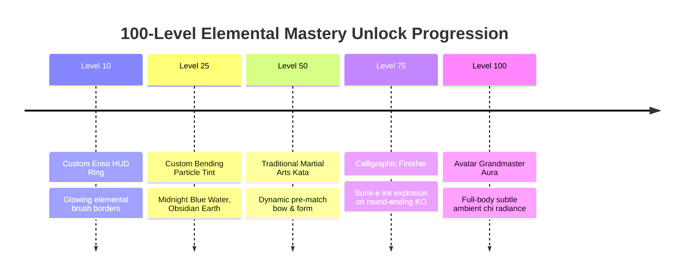
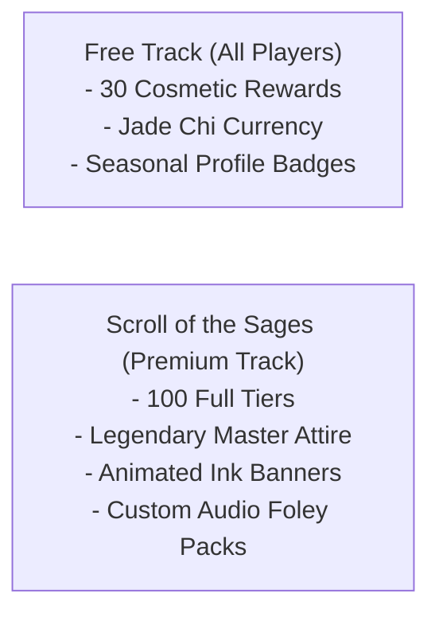
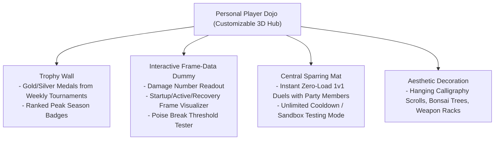
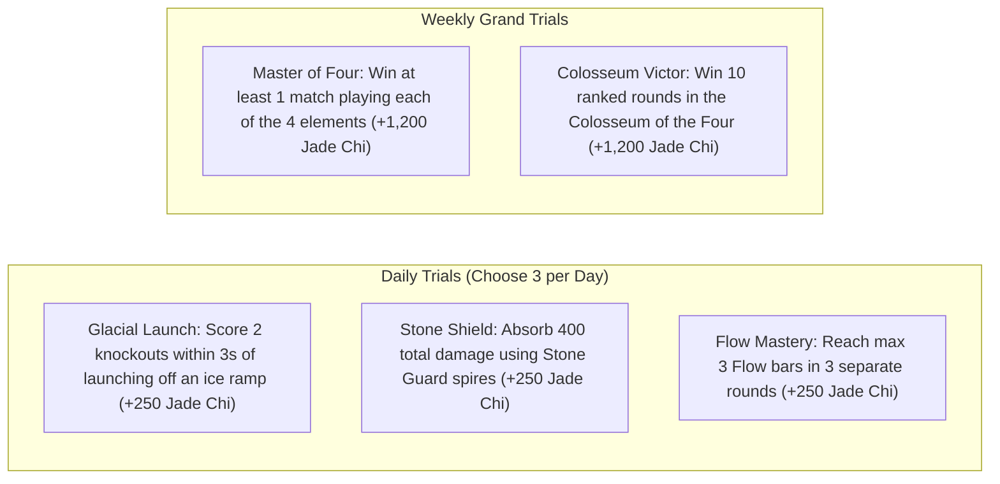

# 14 — Progression, Mastery & Seasonal Content System

## 1. Player Retention Architecture & Core Motivation Loops

To maintain a thriving, long-term competitive playerbase, *Flowbound* implements a multi-layered progression system built entirely on **skill mastery, prestige cosmetics, and social customization**. 

**Strict Non-P2W Mandate:** No gameplay advantage, stat boost, or power-altering item can ever be purchased or unlocked. All players enter the arena with identical mechanical capabilities.

---

## 2. Elemental Discipline Mastery Paths (Levels 1–100)

Every time a player completes a match with an element (Water, Earth, Fire, Air), they earn **Discipline Experience Points (DXP)** based on damage dealt, barriers constructed, and rounds won.

### Master Cosmetic Unlocks by Discipline

| Level Tier | Water Mastery Unlock | Earth Mastery Unlock | Fire Mastery Unlock | Air Mastery Unlock |
| :--- | :--- | :--- | :--- | :--- |
| **Level 10 (HUD)** | Frost-cracked Ice Enso Ring | Carved Basalt Stone Enso Ring | Searing Ember Enso Ring | Gale Spiral Enso Ring |
| **Level 25 (Color)**| *Midnight Abyss* (Dark Indigo) | *Obsidian Volcanic* (Black Glass)| *Emerald Dragon* (Jade Green Fire)| *Crimson Tempest* (Blood Wind) |
| **Level 50 (Emote)**| *Crane on Frozen Waters* Kata | *Iron Mountain Stance* Kata | *Striking Dragon* Kata | *Whirling Cloud* Kata |
| **Level 75 (KO FX)**| Enemy shatters into ice statues | Sinks into cracked earth fissure | Dissolves into burning cherry embers| Swept into ascending wind vortex |
| **Level 100 (Title)**| *"Tidebringer Grandmaster"* | *"Earthshaker Grandmaster"* | *"Flame Sovereign Grandmaster"* | *"Skywalker Grandmaster"* |

---

## 3. The Scroll of Seasons (Seasonal Battle Pass)

Each competitive season lasts **12 weeks** and centers around an overarching martial arts lore chapter accompanied by a 100-tier progression scroll.

### Season Roadmap Themes
- **Season 1: *Rise of the Frozen Fang***
  - Focus: Water & Cryomancy masters.
  - Tier 100 Reward: *Master Kaelen's Glacial Patriarch Silk Robes* with dynamic floating icicle pauldron.
- **Season 2: *The Ashen Forge***
  - Focus: Earth & Lavabending titans.
  - Tier 100 Reward: *Master Orok's Basalt Dragonforged Armor* with pulsating magma core.
- **Season 3: *Eye of the Storm***
  - Focus: Air & Lightning duelists.
  - Tier 100 Reward: *Master Azari's Celestial Thunder Phoenix Robes* with crackling electric trail.

---

## 4. Personal Martial Arts Dojo (Player Housing & Social Hub)

Between matchmaking queues, players spawn inside their personal **3D Mountain Dojo**—a tranquil East Asian sanctuary overlooking a bamboo forest and koi pond.

---

## 5. Daily & Weekly Sages' Trials (Quests)

To encourage diverse playstyles across all four elements, players receive randomized dynamic challenges updated daily and weekly.

### Jade Chi Bazaar (In-Game Cosmetic Shop)
- Jade Chi earned from daily/weekly trials and ranked matches can be redeemed for:
  - Custom martial arts pants colors and silk sash patterns.
  - Traditional wooden training weapons for dojo decoration.
  - Custom ink brush victory banner fonts and player card titles.
