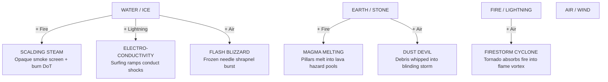
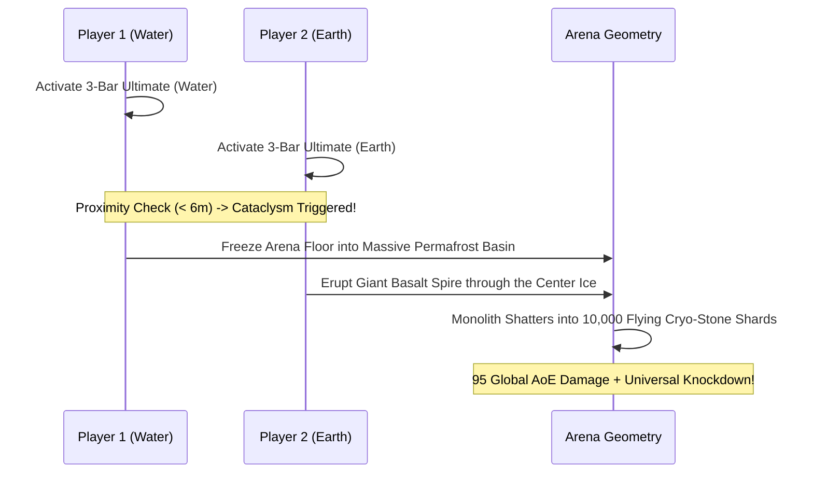

# 15 — Elemental Synergy & Cross-Combo Systems

## 1. Systemic Elemental Reaction Engine

One of the greatest competitive depth pillars in *Flowbound*—particularly in 2v2 Tag Team, 3v3 Objective, and Co-Op PvE modes—is the **Dynamic Reaction Engine**. 

Rather than treating elemental attacks as static damage numbers, spells and environmental constructs physically interact with one another according to consistent thermodynamic and kinetic rules.

---

## 2. Master Elemental Interaction Matrix

| Element A | Element B | Resulting Phenomenon | In-Game Mechanics & Tactical Effect |
| :--- | :--- | :--- | :--- |
| **Water / Ice** | **Fire** | **Scalding Steam Cloud** | Striking an ice wall or water puddle with fire instantly vaporizes it into an 8m dense steam cloud. Vision inside is blocked; enemies take 8 heat damage/sec. |
| **Water / Ice** | **Lightning** | **Electro-Conductive Grid** | Firing a lightning bolt into an ice ramp sends an electric arc traveling through the entire procedural mesh, stunning anyone skating on it for 0.8s. |
| **Water / Ice** | **Air** | **Blizzard Shrapnel** | Directing an air blast through airborne water whips or rain freezes the liquid into hundreds of razor ice needles, creating a shotgun spread dealing 40 damage. |
| **Earth / Stone** | **Fire** | **Magma Slag Puddle** | Sustained fire attacks melt stone spires into glowing molten lava that pools on the floor, dealing 20 burn damage/sec to anyone walking through. |
| **Earth / Stone** | **Air** | **Sandstorm / Dust Devil** | Sweeping a wind wave across earth rubble kicks up a high-velocity dust cloud that reduces enemy draw distance to 3m and strips 30 poise. |
| **Fire** | **Air** | **Firestorm Cyclone** | Casting *Tornado Field* onto active fire consumes the flames, expanding the tornado radius by +50% and dealing 35 burning damage to trapped enemies. |
| **Earth** | **Water** | **Mud Slide Quagmire** | Crushing stone rubble into water puddles creates thick mud, slowing non-waterbenders by 45% and disabling sprint for 3 seconds. |
| **Earth** | **Lightning** | **Grounding Rod** | Raising an Earth Wall immediately absorbs and grounds incoming lightning beams, protecting allies directly behind the barrier. |

---

## 3. Dual-Bending Combiner Ultimates (2v2 Tag-Team Finishers)

When two teammates in 2v2 Tag Team mode each possess **3 full Flow Bars** and activate their ultimate inputs within 6 meters of each other, they trigger a cinematic **Dual Elemental Cataclysm**.

---

### Master Cataclysm Catalog

1. **Glacial Tectonic Shatter (Water + Earth):**
   - The Waterbender flash-freezes the arena floor while the Earthbender erupts a colossal 8-meter basalt monolith from the center, shattering it into an avalanche of razor-sharp ice-boulders dealing 95 AoE damage.
2. **Infernal Firestorm (Fire + Air):**
   - The Airbender summons a colossal hurricane vortex that lifts all opposing players into the sky, while the Firebender hurls continuous streams of blue fire into the funnel, incinerating everything inside (90 AoE damage + 3s burn).
3. **Abyssal Thunderstrike (Water + Lightning):**
   - Water cascades across the entire arena floor in a surging tidal wave that sweeps opponents against the walls, immediately followed by a divine lightning spear from above that electrifies the water surface for 85 lethal damage.
4. **Volcanic Caldera Eruption (Earth + Fire):**
   - Both fighters slam the ground simultaneously, fracturing the arena crust and causing four massive lava geysers to fountain upward, permanently scarring the arena floor with glowing magma channels.
